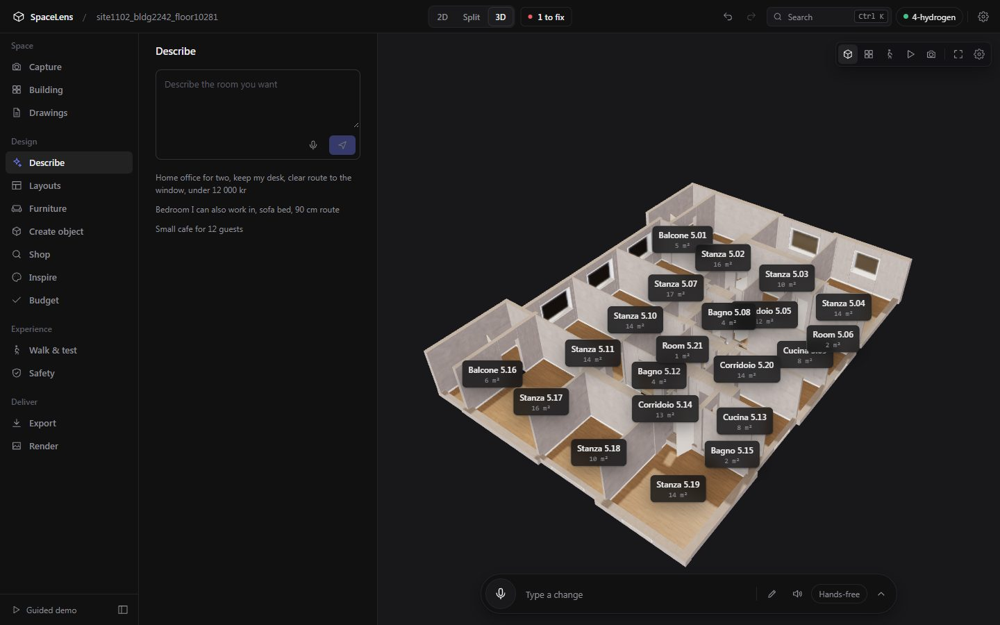
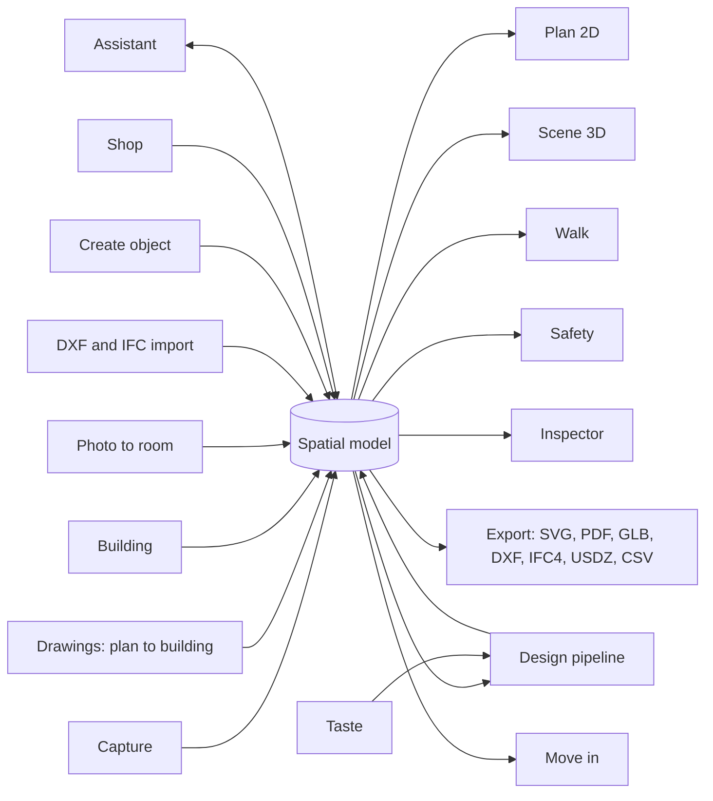
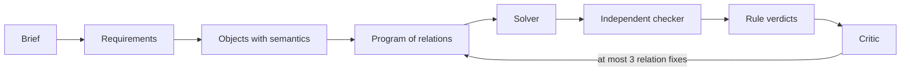

# SpaceLens

**Make blueprints talk: drop in a floor plan and get a measured 3D building, then furnish it with layouts that explain themselves, walk through it, and check that people can reach and get out.**

[](https://github.com/JUNCTION26/SpaceLens/actions/workflows/pages.yml)
[](https://github.com/JUNCTION26/SpaceLens/actions/workflows/ci.yml)
[](LICENSE)


**Live demo:** https://junction26.github.io/SpaceLens/ (runs in the browser, no account, works without a key)
**Watch it work:** https://junction26.github.io/SpaceLens/?show=1 (an 82-second film, no clicks)



Built at Junction 2026 (Espoo) for the Stoa "Make Blueprints Talk" challenge.

## What it does

- **Blueprint to building.** Drop in a vector floor plan (PDF) and SpaceLens builds the whole floor in 3D: one space per room, walls, doors and windows, each wall with evidence pointing back at the page. No model call is needed.
- **Blueprints that answer.** Ask in plain language and get the answer with the evidence highlighted on the page. On the Stoa questions it is right 99.5% of the time it chooses to answer, and it abstains otherwise.
- **Room to model.** Measure with a phone, up to six photos or a short video, or type the size: W, D and H at the top of Space > Measure, a click on a size in the plan, or a sentence such as "make the room 5 by 6".
- **Furnish with reasons.** Describe a space and get several layouts with their reasons, measured numbers and a verdict from an independent checker. Follow-up sentences edit the room that is there. Create any object to size; find real IKEA products that fit.
- **Walk it.** An eye view with W A S D to move, the arrow keys or the mouse to look, Shift to walk faster and Esc to leave.
- **Check it.** Safety has one Drill with a people count, Fire and Access tabs, equipment suggestions, Finland and Sweden rule packs and a printable report. Move in tests each piece through every door.
- **Share it.** Copy a link or show a QR code in Export, send layouts to vote on, and export PDF, GLB, DXF, IFC4, USDZ and a shopping list.
- **Talk to it.** An assistant pinned at the bottom of the panel takes typed or spoken requests, has a hands-free conversation mode, and answers questions about a room or a whole plan instantly, with no model.

The whole interface is one left panel with no pop-ups: messages are one line at the bottom, the inspector is at the top, settings and search are panel content, and the assistant sits at the bottom. More in [docs/FEATURES.md](docs/FEATURES.md); how to use each part in [docs/USAGE.md](docs/USAGE.md).

## Try it

| Link | Shows |
| --- | --- |
| [`?show=1`](https://junction26.github.io/SpaceLens/?show=1) | The hands-free film |
| [`?start=plan`](https://junction26.github.io/SpaceLens/?start=plan) | A real apartment plan turned into 3D |
| [`?start=villa`](https://junction26.github.io/SpaceLens/?start=villa) | A three-bedroom villa, furnished |
| [`?nav=layouts&sample=1&view=split`](https://junction26.github.io/SpaceLens/?nav=layouts&sample=1&view=split) | Layouts with their reasons |
| [`?nav=safety&sample=1&view=split`](https://junction26.github.io/SpaceLens/?nav=safety&sample=1&view=split) | Drill, Fire and Access |

All link parameters are in [docs/USAGE.md](docs/USAGE.md#links). A two-minute spoken script is in [docs/DEMO.md](docs/DEMO.md).

## Results

Measured on the Swiss Dwellings plans and questions of the Stoa dataset, with no model calls:

| Measure | Result |
| --- | --- |
| Plans built into a model | 63 of 65 (96.9%) |
| Printed room areas matched within 2% | 98.7% of 550 (84.4% for rooms built from walls alone) |
| Door counts exactly right | 49.2%, weak |
| Window counts exactly right | 12.3%, weak |
| Questions answered, correct when answered | 1 124 of 2 358, 99.5% |
| Median time to build a plan | 201 ms |

Door and window detection is the weak part and should be checked by eye on the highlighted page. The answerer abstains on about half the questions on purpose: a wrong confident answer on a blueprint is worse than "I cannot tell from this page". Details and reproduction commands: [docs/FEATURES.md](docs/FEATURES.md#blueprint-to-building-benchmark).

## How it stays honest

- **Sources and status on every measurement.** Each value records where it came from and whether it is measured, read, typed or estimated, with an uncertainty range. The Inspector shows the evidence and what-if diffs.
- **An independent checker.** Layouts are generated by the solver, but validity is decided by a separate geometric referee (inside the room, no overlaps, door swing, approach and window access). The solver never returns a layout the referee rejects, and the same checks run on anything you edit by hand.
- **Estimates are labelled.** Generated rooms, shop prices, single-photo scale and evacuation times say that they are estimates wherever they appear.
- **Safety and accessibility are planning aids.** The checks use stated defaults for routes, exits and reach. They do not assess fire resistance, smoke spread, sprinklers, emergency lighting, door forces, stairs and lifts, or your local building and fire code, and the app never claims compliance. See [SAFETY-ASSUMPTIONS.md](docs/SAFETY-ASSUMPTIONS.md) and [RULE-SOURCES.md](docs/RULE-SOURCES.md).
- **Abstaining is allowed.** The drawings answerer only answers when the page evidence supports it.
- **Works without a model.** Every model step has a rule-based fallback, so the app is usable offline and the numbers never depend on a model's say-so.

## Security and privacy

- A Content-Security-Policy ships with production builds. The deployed bundle contains no API key; a key you add stays in your browser and goes only to Gemini.
- An optional API server in `server/` can hold the key instead, with origin checks, per-client and daily limits and a strict request schema. It also stores layout polls, validating every field and refusing any thumbnail that is not a plain SVG.
- What is protected, how, and what is not yet: [SECURITY.md](SECURITY.md) and [docs/THREAT-MODEL.md](docs/THREAT-MODEL.md). What leaves your device and what is stored: [docs/PRIVACY.md](docs/PRIVACY.md).

## Tech stack

Vite, React 18, TypeScript (strict), three.js with react-three-fiber and drei, zustand, pdf.js, Vitest. Gemini over the browser `fetch` API for the optional model features, directly from the page or through the optional zero-dependency API server in `server/`.

## Getting started

Prerequisites: Node.js 22 and npm.

```bash
git clone https://github.com/JUNCTION26/SpaceLens.git
cd SpaceLens
npm ci
npm run dev      # http://localhost:5173
npm test         # unit tests
npm run build    # type-check and production build into dist/
```

No environment variables are required. Without a key every feature uses local logic. To add a Gemini key (optional), paste it into Settings or set `VITE_GEMINI_KEY` in `.env.local` (see `.env.example` and [docs/USAGE.md](docs/USAGE.md#gemini-key-optional)).

## Project structure

```
src/
  core/              spatial model types, geometry, store and undo, model client and router
    ai/              streaming engine, model candidates, health and latency routing
  features/
    capture/         phone camera, A4 calibration, manual drawing, the W D H size row
    photoroom/       photos or a video to an editable room
    drawings/        PDF, image and DXF reader, text index, evidence answers
    formats/         DXF read and write, IFC read and write
    building/        shell, programme, partition, assembly, whole-building tour
    intent/          request to typed requirements, follow-up room edits
    design/ layout/  planner, relations, solver, rules, critic; layout panel
    referee/         independent geometric checker
    forge/           object creation: parse, generate, fit, validate, library
    furniture/       catalogue and Poly Haven models
    stores/ budget/  product finder with page verification; budget moves
    agent/           the assistant: brain, instant answers, sketches, speech
    sim/ scene3d/    routes and door passage; 3D scene and the eye view
    safety/          drill, escape routes, accessibility, equipment, report
    jurisdiction/    Finland and Sweden rule packs with sources
    movein/          carry-in check per door, arrival order
    export/          SVG, PDF, CSV, GLB, JSON, share link, QR
    demo/            one-click starts, guided demo, the hands-free film
    plan2d/ xr/      plan editor, WebXR entry and AR measure
  ui/                the left-panel shell, home, settings, themes
scripts/             benchmark runners, object generation checks, rule table generator
server/              optional API server: model, image and speech routes, in-memory polls (see server/README.md)
docs/                features, usage, architecture, design rules, rule sources, safety assumptions, demo script
public/              example drawings, Poly Haven models and textures, web app manifest
```

## Architecture



All inputs write into one spatial model that every view reads. Edits go through a single store with undo, so manual tools and the assistant behave the same way. The full reference (diagrams, module map and dependency rule, data model, the independent checker, AI routing, state and undo, testing) is in [docs/ARCHITECTURE.md](docs/ARCHITECTURE.md); the reasons behind the main decisions are short records in [docs/adr/](docs/adr/README.md). `npm run check:boundaries` enforces the layering rules.

### Design pipeline



The planner decides intent (zones and relations, each with a reason) but never geometry. The solver turns relations into exact positions. The checker accepts or rejects them, the 42 rules score them, and the critic can send back relation edits for one more round. Without a model the planner and critic use rule-based fallbacks.

## Testing

```bash
npm run typecheck    # tsc -b
npm test             # Vitest, hermetic: no network and no key needed
npm run test:server  # API server tests
npm run docs:rules   # print the design rule table (docs/DESIGN-RULES.md)
npm run docs:safety  # print the safety defaults (docs/SAFETY-ASSUMPTIONS.md)
```

Tests cover geometry, the store, the design solver and rules, the critic, the referee, drawings answering, object validation, shop parsing, safety, rule packs, DXF reading, IFC and USDZ output, the move-in plan, taste learning, the shopping list, poll validation and the assistant's pure logic. Tests that need the network or a key are opt-in behind environment flags.

## Deployment

`.github/workflows/pages.yml` runs the tests, builds with the Pages base path and deploys `dist/` to GitHub Pages on every push to `main`. `.github/workflows/ci.yml` runs type-check, tests and build on every push and pull request. Neither needs secrets.

## Known limitations

- Not yet tried on real devices: AR (WebXR and the USDZ file in AR Quick Look), VR, and voice with a real microphone. Their logic is unit-tested.
- Product search rarely verifies a match: it covers IKEA Sweden and Finland and depends on web search finding the page.
- Plan-picture and video import have never run end to end.
- IFC import reads rooms only (extruded footprints).
- Door and window counts from a plan are weak; the answerer abstains on about half of the Stoa questions.
- Safety and accessibility checks are planning aids on stated defaults, not a code compliance check; the rule packs cover only the values in [RULE-SOURCES.md](docs/RULE-SOURCES.md).
- No accounts or database: models live in your browser, and polls live in server memory (48 hours).
- Model features need a Gemini key and its quota.

## Roadmap

- A server-side proxy for the model so keys never reach the browser.
- Native capture with RoomPlan (iOS) and ARCore (Android).
- Stitching several rooms captured separately into one model.
- Curved and angled walls in the building step.
- Scanned drawings through vision, with the same evidence highlighting.
- Better door and window detection in the plan-to-building step.

## Credits

- 3D models, textures and the HDRI are from [Poly Haven](https://polyhaven.com), released under CC0. Details in [`public/assets/models/CREDITS.md`](public/assets/models/CREDITS.md) and [`public/assets/CREDITS-env.md`](public/assets/CREDITS-env.md).
- Example floor plans are from the Swiss Dwellings dataset as provided with the Stoa challenge, licensed CC BY 4.0.

## Contributing

Issues and pull requests are welcome. See [CONTRIBUTING.md](CONTRIBUTING.md); in short, run `npm run typecheck`, `npm run check:boundaries`, `npm test` and `npm run build` first, as CI does. Security reports go through [SECURITY.md](SECURITY.md).

## License

[MIT](LICENSE)

## Author

[shafir-01](https://github.com/shafir-01), with the team Shafir Khajo, Julius Hänninen and Kalle Pentikäinen.
