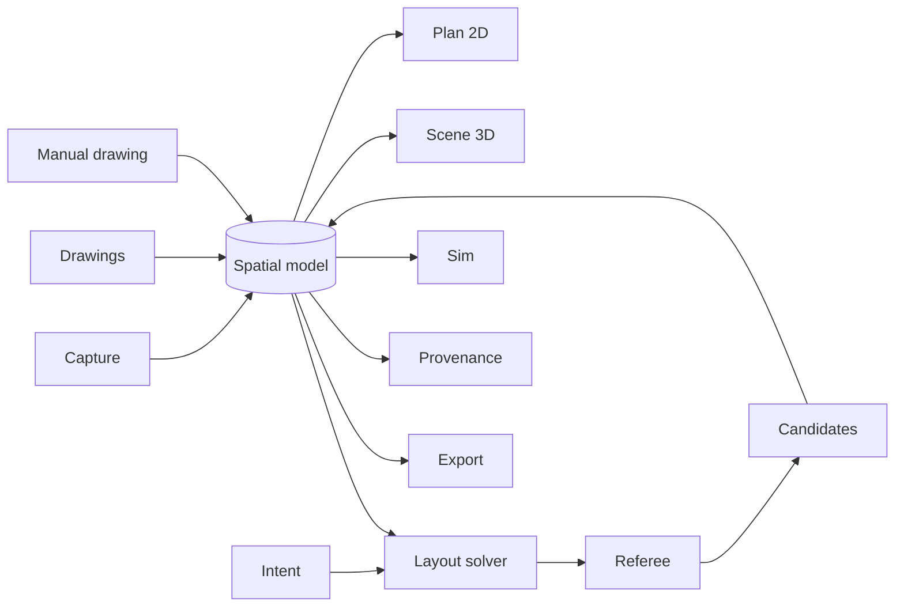

# SpaceLens

**Measure a room, redesign it, walk through it.**

[](https://github.com/JUNCTION26/SpaceLens/actions/workflows/pages.yml)
[](LICENSE)


**Live demo:** https://junction26.github.io/SpaceLens/

## What it does

SpaceLens turns a room into a working model you can trust. Measure it with your phone camera, read it from a drawing, or type the dimensions in. Then describe what you want, let the app propose layouts that actually fit, and walk through the result in 3D before anything is bought or moved.

Built at Junction 2026 (Espoo) for the Stoa "Make Blueprints Talk" challenge.

## Features

**Capture**
- Phone camera capture with floor-plane calibration from an A4 sheet
- Manual measured drawing for when a photo is not practical

**Drawings**
- Open PDF or image blueprints and index their dimensions and room labels
- Ask questions about a drawing and see the evidence highlighted on the page
- Answers come from the local index first; Gemini is used only as a fallback
- Trace a drawing into the 3D model

**Design**
- Plain-language requests turned into typed constraints (Gemini or built-in rules)
- Layout solver that proposes candidates, explains infeasible requests and suggests relaxations
- Editable, dimensioned 2D plan

**Experience**
- Dollhouse view and first-person walk-through
- Routes checked against body profiles
- Will-it-fit-through-the-door search over position and rotation
- Sightlines and a crowd heatmap

**Deliver**
- SVG and PDF plan, CSV schedule, GLB model, JSON and a share link
- Evidence for every measurement, uncertainty ranges and what-if diffs

## How it stays honest

- Every measurement carries its source and a status, so you can tell what was measured, read from a drawing or assumed.
- Every proposed layout must pass an independent geometric checker with its own geometry code before it is shown as valid.
- Estimates such as prices and uncertain dimensions are labelled as estimates.
- Lighting in the 3D view is illustrative, not a light simulation.

## Tech stack

- [Vite 5](https://vitejs.dev/) + [React 18](https://react.dev/) + TypeScript
- [three.js](https://threejs.org/) with [@react-three/fiber](https://github.com/pmndrs/react-three-fiber) and [drei](https://github.com/pmndrs/drei)
- [zustand](https://github.com/pmndrs/zustand) for state
- [pdfjs-dist](https://github.com/mozilla/pdf.js) for reading drawings
- [Vitest](https://vitest.dev/) for tests
- Gemini API (optional), called from the browser

## Getting started

Prerequisites: Node.js 22 (or 18+) and npm.

```bash
git clone https://github.com/JUNCTION26/SpaceLens.git
cd SpaceLens
npm install
npm run dev      # start the dev server
npm test         # run the test suite
npm run build    # type-check and build to dist/
```

No environment variables are needed. Everything works offline with local logic.

### Gemini setup (optional)

1. Get a key at [aistudio.google.com/apikey](https://aistudio.google.com/apikey).
2. Open **Settings** in the app and paste it in.

The key is stored only in your browser and sent directly to the Gemini API. Without a key, every feature falls back to local logic. Calling the model from the browser is fine for a prototype; a production version would proxy it through a server so the key never reaches the client.

## Project structure

```
src/
  core/            shared spatial model, types, geometry, store, Gemini client
  features/
    capture/       phone camera, A4 calibration, manual drawing
    drawings/      PDF/image reader, dimension index, evidence answers
    intent/        request to typed constraints
    layout/        layout solver, infeasibility explanations
    referee/       independent geometric checker
    sim/           routes, door passage, sightlines, crowd heatmap
    provenance/    evidence, uncertainty, what-if diffs
    export/        SVG/PDF, CSV, GLB, JSON, share link
    furniture/     furniture definitions
    plan2d/        editable dimensioned plan
    scene3d/       dollhouse and first-person walk
  ui/              app shell, top bar, toasts, theme
```

## Architecture



All inputs write into one spatial model. The 2D plan and 3D scene render from it. A request becomes constraints, the solver searches for layouts, and only layouts the referee accepts become candidates. Simulation and provenance read the model without changing it, and export writes it out.

## Known limitations

- This is a prototype with no backend; data lives in your browser.
- Single-photo scale needs a reference object, such as an A4 sheet.
- Route checks are geometric, not legal or accessibility compliance checks.
- Prices are estimates.
- 3D lighting is illustrative.
- Furniture passage checks use the 2D footprint.

## Roadmap

- Server-side model proxy
- Native capture with RoomPlan (iOS) and ARCore (Android)
- Stitching multiple rooms into one model
- Real furniture catalog feeds

## Contributing

Issues and pull requests are welcome. Please run `npm run typecheck`, `npm test` and `npm run build` before opening a PR; CI runs the same checks.

## License

[MIT](LICENSE)

## Author

shafir-01
