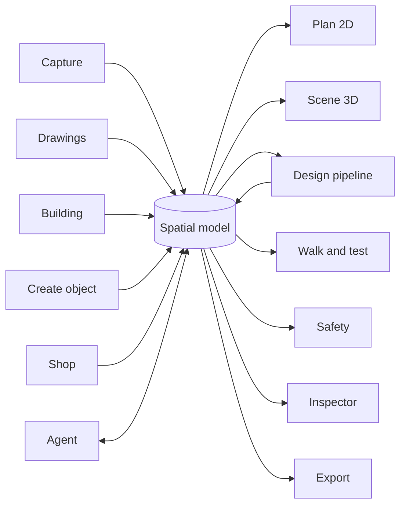
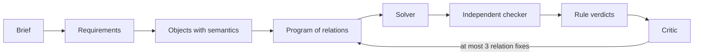
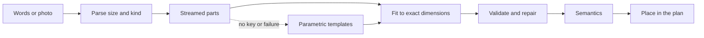

# SpaceLens

**Make blueprints talk: read a drawing or a room, turn it into a measured 3D building, design it with layouts that explain themselves, and check that people can walk, reach and get out.**

[](https://github.com/JUNCTION26/SpaceLens/actions/workflows/pages.yml)
[](https://github.com/JUNCTION26/SpaceLens/actions/workflows/ci.yml)
[](LICENSE)


**Live demo:** https://junction26.github.io/SpaceLens/ (runs in the browser, no account, works without a key)


Built at Junction 2026 (Espoo) for the Stoa "Make Blueprints Talk" challenge.

## What it does

- **Reads blueprints.** Open a PDF or image plan, ask a question in plain language, and get the answer with the evidence highlighted on the page. On the Stoa questions it is right 99.5% of the time it chooses to answer, and it abstains otherwise ([numbers](#the-stoa-benchmark)).
- **Builds from a blueprint or a room.** Trace a drawing, measure a room with a phone camera and an A4 sheet, type dimensions, or generate a whole floor from a room programme. Everything lands in one spatial model.
- **Designs with reasons.** Say who uses the space. The app proposes layouts, and every placement carries the rule it satisfies, the measured numbers, and a verdict from an independent checker.
- **Creates objects and finds real ones.** Describe a piece of furniture and it is generated to your exact dimensions, or search real shops for products that fit the room and the door.
- **Tests the result.** Walk through it, test routes against body profiles, check exits and wheelchair reach, simulate an evacuation, and export the plan, schedule, model and a printable evacuation plan.

An agent you can talk to sits over all of it: it answers about the room, sketches what it means on the plan, and then makes the change.

## Screenshots

| | |
| --- | --- |
|  **Drawings.** Questions about a blueprint, answered from the page text with the evidence highlighted. |  **Building.** Outer shell and room programme become walls, doors and windows. |
|  **Layouts.** Candidates with rule verdicts and the decisions behind them. |  **Create object.** A described piece, fitted to your dimensions and validated. |
|  **Shop.** Real listings checked against budget, free floor and the door. |  **Walk and test.** First-person walk, routes, door passage, sightlines. |
|  **Safety.** Exits, travel distance, wheelchair access and an evacuation estimate. |  **Export.** Plans, schedules, a 3D model and a share link. |

## Features

**Capture**
- Phone camera capture with floor-plane calibration from an A4 sheet, and a manual measured drawing for when a photo is not practical.
- Every measurement keeps its source (measured, read from a drawing, typed, or estimated) and an uncertainty.

**Drawings**
- Open PDF or image blueprints and index their text, dimensions, scale and room labels in the browser.
- Ask about counts, areas, lengths and labels, in several languages. Answers come from the local index first and name their kind: printed on the page, calculated, or inferred. Gemini is a fallback, never the first choice.
- Highlighted evidence regions on the page for every answer.

**Building**
- Pick an outer shell (rectangle, L-shape or the current room), an entrance and windows, then a room programme (for example a villa with three bedrooms) or describe one in words.
- A partition step divides the floor into rooms with minimum widths and zones, checks connectivity, and assembles one space per room with shared walls, doors on both sides and windows on facades. All of it is labelled as a generated estimate.
- Rooms can be furnished from the same design pipeline.

**Design**
- Describe who uses a space and how; the request becomes typed requirements (people, items, budget, lock what must stay).
- A layout solver places pieces from relations (against a wall, faces, flanks, beside, in front of, on a rug and more), returns several different candidates, and ranks them by 42 design rules ([list](docs/DESIGN-RULES.md)).
- When a request cannot be satisfied, it says why and suggests the smallest relaxation.
- A second-opinion critic judges the major decisions and may propose at most three fixes; fixes go back through the solver and the rules like any other change.
- Editable, dimensioned 2D plan, a 3D dollhouse, and furniture from the Poly Haven library.
- Inspire: take a style and palette from a photo.

**Create object**
- Describe any piece in words, or from a photo. The model streams its parts, the object assembles on screen while it is written, and the result is fitted to your exact dimensions.
- Each object has semantics (role, use zones, how it opens or unfolds) so the design rules treat it like a catalogue piece.
- Geometry is validated and repaired automatically; without a key a parametric template library takes over.

**Shop**
- Search real listings for a request such as "grey 3-seat sofa under 6 000 kr, max 220 cm wide". Prices and sizes are read from the product page itself.
- Each listing is checked against the budget, a free spot in the room and the door, and can be placed into the plan as a stand-in.
- The choice is decided by measured facts; a model only words the reasons.

**Walk and test**
- Dollhouse and first-person walk, with optional WebXR where the device supports it.
- Routes checked against body profiles, a will-it-fit-through-the-door search over position and rotation, sightlines, and a crowd heatmap.

**Safety**
- Escape routes for the whole model: travel distance to an exit, dead ends, a second exit above a set occupancy, door swing, clear zones at exits, wheelchair route widths, turning space and reach.
- Extinguisher and smoke alarm placement, an evacuation estimate with queueing at doors, small suggested moves, and a printable A4 evacuation plan.
- Every threshold is a visible, editable default with its reason ([assumptions](docs/SAFETY-ASSUMPTIONS.md)).

**Deliver**
- SVG and PDF plan, CSV schedule and quantities, GLB model, JSON, a share link, and the evacuation plan.

**The talking agent**
- Ask by voice or text, with optional hands-free mode and spoken replies.
- It sees a compact picture of the room, so "the wall by the window" and "that one" resolve to real things.
- Before it changes anything it sketches the change on the plan, then acts through the same store and checker as the manual tools. Everything is undoable.

## How it stays honest

- **Sources and status on every measurement.** Each value in the model records where it came from and whether it is measured, read, typed or estimated, with an uncertainty range. The Inspector shows the evidence and what-if diffs.
- **An independent checker.** Layouts are generated by the solver, but validity is decided by a separate geometric referee (inside the room, no overlaps, door swing, approach and window access). The solver never returns a layout the referee rejects, and the same checks run on anything you edit by hand.
- **Estimates are labelled.** Generated rooms, shop prices, single-photo scale and evacuation times say that they are estimates wherever they appear.
- **Safety and accessibility are planning aids.** The checks use stated rule-of-thumb defaults for routes, exits and reach. They do not assess fire resistance, smoke spread, sprinklers, emergency lighting, door forces, stairs and lifts, or your local building and fire code, and the app never claims compliance. See [SAFETY-ASSUMPTIONS.md](docs/SAFETY-ASSUMPTIONS.md).
- **Abstaining is allowed.** The drawings answerer only answers when the page evidence supports it. That is why its accuracy when it answers is high and its coverage is not complete.
- **Works without a model.** Every model step has a rule-based fallback, so the app is usable offline and the numbers never depend on a model's say-so.

## The Stoa benchmark

The drawings answerer was run against the Swiss Dwellings questions from the Stoa challenge dataset (65 floor-plan PDFs, 2 358 questions, counts scored exactly and areas, lengths and volumes within 2%). The run uses the app's own answering code, makes no model calls and takes about 0.4 ms per question.

| | Questions | Answered | Correct | Accuracy when answered |
| --- | ---: | ---: | ---: | ---: |
| All | 2 358 | 1 124 | 1 118 | **99.5%** |
| Counts | 1 614 | 940 | 940 | 100% |
| Areas | 744 | 184 | 178 | 96.7% |

It abstained on 1 234 questions (coverage 47.7%), so the share of all questions answered correctly is 47.4%. The reasoning is deliberate: a wrong confident answer on a blueprint is worse than saying "I cannot tell from this page". The full result and examples are in [`public/samples/stoa/eval-results.json`](public/samples/stoa/eval-results.json), and three sample plans ship with the app (Drawings, then Samples).

Reproduce it with the dataset on disk:

```bash
node scripts/stoa-eval.mjs <path-to>/junction-dataset-preview --source swiss_dwellings --limit 2358
```

The run rewrites `public/samples/stoa/eval-results.json`.

## Tech stack

Vite, React 18, TypeScript (strict), three.js with react-three-fiber and drei, zustand, pdf.js, Vitest. Gemini over the browser `fetch` API for the optional model features. No backend.

## Getting started

Prerequisites: Node.js 22 and npm.

```bash
git clone https://github.com/JUNCTION26/SpaceLens.git
cd SpaceLens
npm ci
npm run dev      # http://localhost:5173
npm test         # unit tests
npm run build    # type-check and production build into dist/
```

No environment variables are required. Without a key every feature uses local logic.

### Gemini key (optional)

1. Create a key at [aistudio.google.com/apikey](https://aistudio.google.com/apikey).
2. Paste it into **Settings** in the app, or put `VITE_GEMINI_KEY=<your key>` in `.env.local` for local development (see `.env.example`).

The key stays in your browser and is sent only to the Gemini API. That is a deliberate prototype trade-off: calling the model from the page keeps the project backend-free, but any key embedded in a deployed bundle can be read by its visitors, so the deployed site ships without one. A production version would put a small proxy in front of the model.

The model router picks, per task (fast, smart, vision), the first candidate model that is healthy and quick for your key, so a key with more quota simply unlocks better models.

## Deep links

Every section can be opened directly, which is how the demo and the screenshots are made:

```
?nav=<capture|building|drawings|describe|layouts|furniture|create|shop|inspire|walk|safety|export>
 &sample=1          load the sample room
 &view=<2d|split|3d>
 &theme=<dark|light>
 &coach=0           skip the first-run tour
 &open=<settings|command|checks|demo>
```

Examples: [Building](https://junction26.github.io/SpaceLens/?nav=building&sample=1&view=split), [Layouts](https://junction26.github.io/SpaceLens/?nav=layouts&sample=1&view=split), [Safety](https://junction26.github.io/SpaceLens/?nav=safety&sample=1&view=2d), [guided demo](https://junction26.github.io/SpaceLens/?sample=1&open=demo). A 2-minute script is in [docs/DEMO.md](docs/DEMO.md).

## Project structure

```
src/
  core/              spatial model types, geometry, store and undo, model client and router
    ai/              streaming engine, model candidates, health and latency routing
  features/
    capture/         phone camera, A4 calibration, manual drawing
    drawings/        PDF and image reader, text index, evidence answers
    building/        shell, programme, partition, connectivity, assembly into a model
    intent/          request to typed requirements
    design/          planner, relations, solver, rules, critic, pipeline, scoring
    layout/          layout panel and infeasibility explanations
    referee/         independent geometric checker
    forge/           object creation: parse, generate, fit, validate, materials, library
    furniture/       catalogue and Poly Haven models
    stores/          shop search, listing reader, fit and price advice
    agent/           the talking agent: brain, actions, sketches, speech
    sim/             routes, door passage, sightlines, crowd heatmap
    safety/          escape routes, accessibility, evacuation, printable plan
    provenance/      evidence, uncertainty, what-if diffs
    export/          SVG and PDF, CSV, GLB, JSON, share link
    plan2d/ scene3d/ xr/   plan editor, 3D scene, WebXR
  ui/                app shell, sidebar, coach, settings, themes
scripts/             benchmark runner, rule table generator, headless screenshots
docs/                architecture, design rules, safety assumptions, demo script
public/              sample drawings, Poly Haven models and textures
```

## Architecture



All inputs write into one spatial model that every view reads. Edits go through a single store with undo, so manual tools and the agent behave the same way.

### Design pipeline



The planner decides intent (zones and relations, each with a reason) but never geometry. The solver turns relations into exact positions. The checker accepts or rejects them, the 42 rules score them, and the critic can send back relation edits for one more round. Without a model the planner and critic use rule-based fallbacks.

### Object creation



More detail in [docs/ARCHITECTURE.md](docs/ARCHITECTURE.md).

## Testing

```bash
npm run typecheck    # tsc -b
npm test             # Vitest, hermetic: no network and no key needed
npm run docs:rules   # print the design rule table (docs/DESIGN-RULES.md)
npm run docs:safety  # print the safety defaults (docs/SAFETY-ASSUMPTIONS.md)
```

Tests cover geometry, the store, the design solver and rules (including room scenarios), the critic, the referee, drawings answering, object validation, shop parsing, safety and the agent's pure logic. Tests that need the network or a key are opt-in behind environment flags.

## Deployment

`.github/workflows/pages.yml` runs the tests, builds with the Pages base path and deploys `dist/` to GitHub Pages on every push to `main`. `.github/workflows/ci.yml` runs type-check, tests and build on every push and pull request. Neither needs secrets.

## Known limitations

- A prototype with no backend: models live in your browser and are not synced.
- Single-photo scale needs a reference object, such as an A4 sheet.
- The drawings answerer abstains on about half of the Stoa questions and is weakest on areas; it reads text-based PDFs, not scans.
- Safety and accessibility checks are planning aids on stated defaults, not a code compliance check.
- Generated floors and rooms are estimates; walls are straight and rectilinear.
- Furniture passage and the design rules work on 2D footprints plus stated heights.
- Shop results depend on what the shop pages expose, and prices are as read at search time.
- 3D lighting is illustrative.
- Model features need a Gemini key and the quota of that key.

## Roadmap

- A server-side proxy for the model so keys never reach the browser.
- Native capture with RoomPlan (iOS) and ARCore (Android).
- Stitching several rooms captured separately into one model.
- Curved and angled walls in the building step.
- Real furniture catalogue feeds.
- Scanned drawings through vision, with the same evidence highlighting.

## Credits

- 3D models, textures and the HDRI are from [Poly Haven](https://polyhaven.com), released under CC0. Details in [`public/assets/models/CREDITS.md`](public/assets/models/CREDITS.md) and [`public/assets/CREDITS-env.md`](public/assets/CREDITS-env.md).
- Sample floor plans are from the Swiss Dwellings dataset as provided with the Stoa challenge, licensed CC BY 4.0.

## Contributing

Issues and pull requests are welcome. Run `npm run typecheck`, `npm test` and `npm run build` first; CI runs the same checks.

## License

[MIT](LICENSE)

## Author

[shafir-01](https://github.com/shafir-01), with the team Shafir Khajo, Julius Hänninen and Kalle Pentikäinen.
