# SpaceLens

**Make blueprints talk: drop in a floor plan and get a measured 3D building, then furnish it with layouts that explain themselves, walk through it, and check that people can reach and get out.**

[](https://github.com/JUNCTION26/SpaceLens/actions/workflows/pages.yml)
[](https://github.com/JUNCTION26/SpaceLens/actions/workflows/ci.yml)
[](LICENSE)


**Live demo:** https://junction26.github.io/SpaceLens/ (runs in the browser, no account, works without a key)


Built at Junction 2026 (Espoo) for the Stoa "Make Blueprints Talk" challenge.

## What it does

- **Blueprint to building.** Drop in a vector floor plan (PDF) and SpaceLens builds the whole floor in 3D: one space per room, walls, doors and windows, each wall with evidence pointing back at the page. No model call is needed ([benchmark](#blueprint-to-building)).
- **Blueprints that answer.** Ask a question in plain language and get the answer with the evidence highlighted on the page. On the Stoa questions it is right 99.5% of the time it chooses to answer, and it abstains otherwise ([numbers](#the-stoa-benchmark)).
- **Furnish a whole building.** Furnish every room, walk through the doors, take an automatic tour. Layouts come with their reasons, the measured numbers, and a verdict from an independent checker.
- **Create any object, find real ones.** Describe a piece and it is generated to your exact dimensions, or search real shops for products that fit the room, the door and the budget.
- **Photo to room.** Take one photo of a real room and get an editable model with the furniture in it, then measure one wall to fix the scale.
- **Plan the move-in.** Check that every piece can be carried through the entrance and each door on the way to its room, and get an order for it to arrive.
- **Share and vote.** Send two to four layouts to the people you live with and see which one wins.
- **Learns your taste.** Layouts lean toward what you keep, skip and move, and you can see and clear what it learned.
- **Test the result.** Walk it, test routes against body profiles, check exits and wheelchair reach, simulate an evacuation, and export plans, a schedule, a 3D model and a printable evacuation plan.

An agent you can talk to sits over all of it: say "add a pink princess bed" and it sketches what it means on the plan, then makes the change.

## Blueprint to building

The Drawings panel turns a vector floor plan into a spatial model: room outlines become spaces, wall thickness comes from the drawing, door symbols and window openings are placed on the walls they sit in, and printed room areas are checked against the computed ones. It runs in the browser in about 0.2 s per plan with zero model calls.

Benchmark on the 65 Swiss Dwellings plans of the Stoa dataset (`node scripts/stoa-build.mjs`, results in [`public/samples/stoa/build-results.json`](public/samples/stoa/build-results.json)):

| Measure | Result |
| --- | --- |
| Plans built | 63 of 65 (96.9%) |
| Rooms closed into an outline | 1 602 of 1 618 numbered rooms (99%) |
| Printed room areas matched within 2% | 98.7% of 550, median error 0% |
| Same check on rooms built from walls alone | 84.4% of 390 within 2%, median error 0.32% |
| Room-area questions answered from the built model | 130 of 130 |
| Room-count questions (by label) | 388 of 405 (95.8%) |
| Door counts exactly right | 49.2% (32 of 65), weak |
| Window counts exactly right | 12.3% (8 of 65), weak |
| Median time per plan, model calls | 201 ms, 0 |

Read these plainly. The 98.7% figure relies on room outlines that are drawn in the PDFs; when a room is built from its walls alone the share within 2% is 84.4%. Door and window detection is the weak part of the build and its counts should be checked by eye on the highlighted page. Plans that are scans rather than vector drawings are not handled.

## Screenshots

| | |
| --- | --- |
| 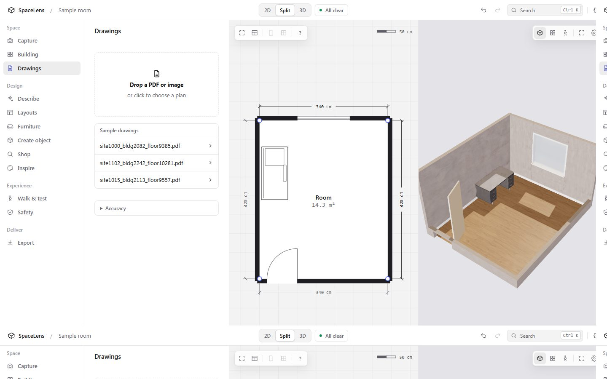 **Drawings.** 21 rooms, 18 doors and 11 windows found on a real plan, with printed and computed areas side by side. | 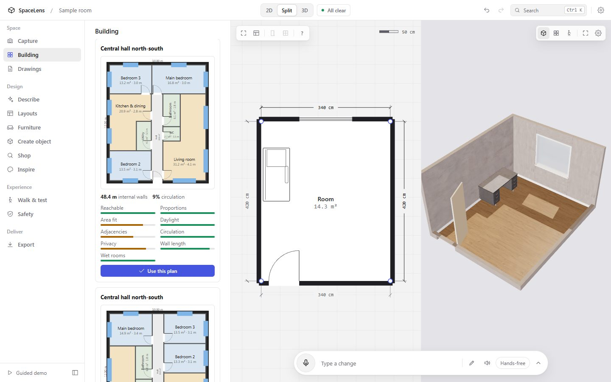 **Building.** Outer shell and room programme become a furnished-ready floor. |
| 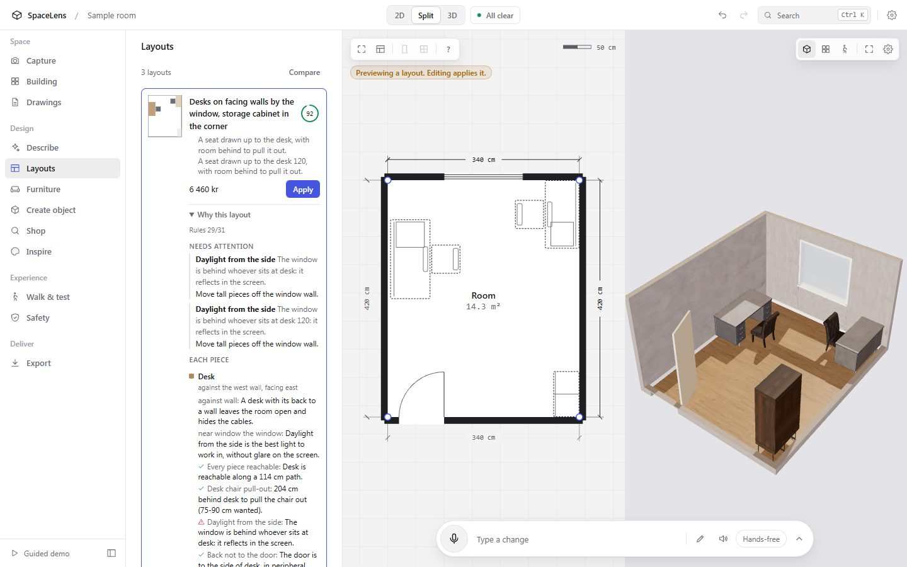 **Layouts.** Candidates with rule verdicts and the decisions behind them. | 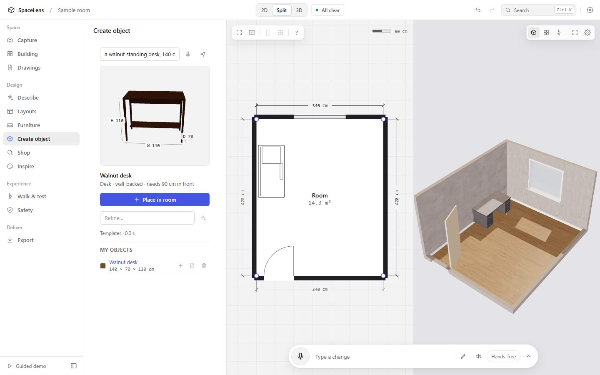 **Create object.** A described piece generated by Gemini, fitted to your dimensions. |
| 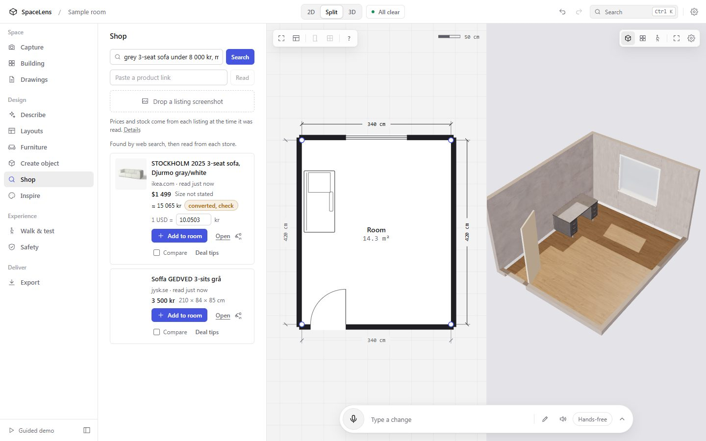 **Shop.** Real listings checked against budget, free floor and the door. | 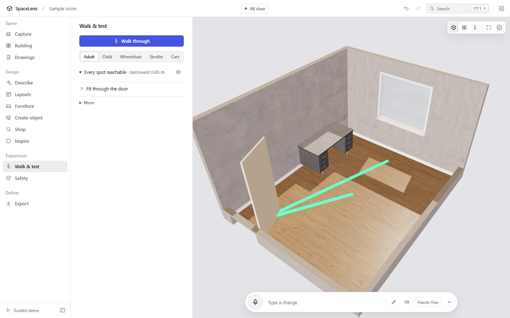 **Walk and test.** First-person walk, routes by body profile, door passage. |
| 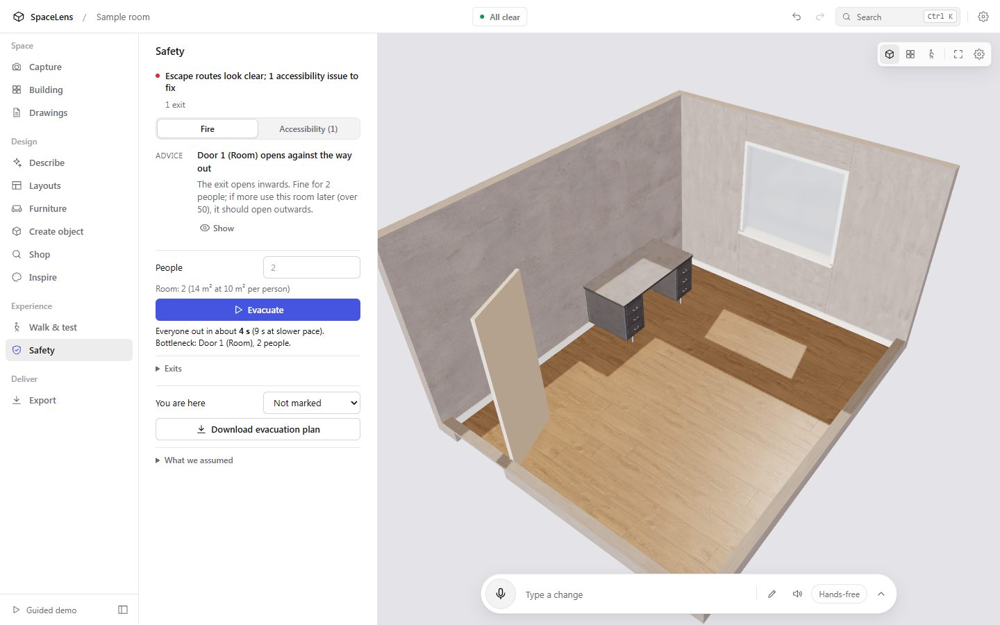 **Safety.** Exits, travel distance, wheelchair access and an evacuation estimate. | 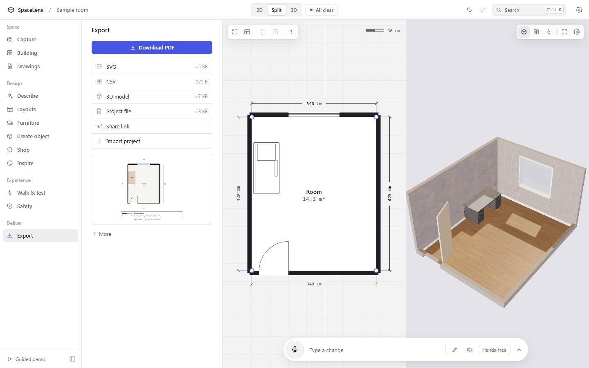 **Export.** Plans, schedules, a 3D model and a share link. |

## Features

**Capture**
- Phone camera capture with floor-plane calibration from an A4 sheet, and a manual measured drawing for when a photo is not practical.
- Every measurement keeps its source (measured, read from a drawing, typed, or estimated) and an uncertainty.

**Photo to room**
- One photo of a room is read by a Gemini vision model into a rectangular room (width, depth, ceiling height), its doors and windows, and each piece of furniture with its size and position. Each piece starts from the closest catalogue item; anything else becomes a generated custom object at its estimated size.
- Everything from the photo is marked photo-inferred and estimated, with the model's confidence. Typing the real length of one wall afterwards marks that wall user-measured and rescales the room.
- Needs a Gemini key (your own or the optional server). Stronger vision models are tried first.

**Drawings**
- Open PDF or image blueprints and index their text, dimensions, scale and room labels in the browser.
- Ask about counts, areas, lengths and labels, in several languages. Answers come from the local index first and name their kind: printed on the page, calculated, or inferred. Gemini is a fallback, never the first choice.
- Highlighted evidence regions on the page for every answer.

**Blueprint to building**
- Vector PDF plans become a multi-room model with evidence on every wall; see the benchmark above.
- ASCII DXF files open in the Drawings panel too: lines, polylines, arcs, circles, block inserts and text are read, units come from the file header (when the file does not say, they are guessed from the drawing's extent and the result is flagged), and rooms are built from the outlines. DXF files are treated as untrusted input and capped at 400 000 entities.
- Whole buildings can be furnished room by room, walked through doors, and toured automatically.

**Building**
- Pick an outer shell (rectangle, L-shape or the current room), an entrance and windows, then a room programme (for example a villa with three bedrooms) or describe one in words.
- A partition step divides the floor into rooms with minimum widths and zones, checks connectivity, and assembles one space per room with shared walls, doors on both sides and windows on facades. All of it is labelled as a generated estimate.
- Rooms can be furnished from the same design pipeline.

**Design**
- Describe who uses a space and how; the request becomes typed requirements (people, items, budget, lock what must stay).
- A layout solver places pieces from relations (against a wall, faces, flanks, beside, in front of, on a rug and more), returns several different candidates, and ranks them by 42 design rules ([list](docs/DESIGN-RULES.md)).
- When a request cannot be satisfied, it says why and suggests the smallest relaxation.
- A second-opinion critic judges the major decisions and may propose at most three fixes; fixes go back through the solver and the rules like any other change.
- Editable, dimensioned 2D plan, a 3D dollhouse, and furniture from the Poly Haven library.
- Inspire: take a style and palette from a photo.
- Layout search has a hard wall-clock ceiling (20 s by default). Past it the search stops expanding and returns the best layout found so far.

**Taste**
- The app learns from what you do: which layouts you apply or skip, what you move, add or remove, colours and materials you pick, and budgets you set. Signals fade with a 21-day half-life.
- From them it builds a small profile (open floor or full, against the wall or floating, symmetric or relaxed, how much you spend, where desk, bed and sofa sit relative to the window, favourite colours and materials, categories you keep removing). A trait with too little evidence is ignored.
- The profile nudges the layout solver weights and some design rules and adds short hints to the planner prompt. It is shown in the Layouts and Style panels, can be switched off and cleared, and lives only in your browser storage.

**Create object**
- Describe any piece in words, or from a photo. The model streams its parts, the object assembles on screen while it is written, and the result is fitted to your exact dimensions.
- Each object has semantics (role, use zones, how it opens or unfolds) so the design rules treat it like a catalogue piece.
- Geometry is validated and repaired automatically; without a key a parametric template library takes over.
- Measured on 18 varied prompts with the lite Gemini models: 14 recognisable at a glance and 4 partly so, first parts on screen after about 1.15 s and the complete object after about 2.2 s (median). Results and renders are kept with the generation scripts.

**Shop**
- Search real listings for a request such as "grey 3-seat sofa under 6 000 kr, max 220 cm wide". Prices and sizes are read from the product page itself.
- Each listing is checked against the budget, a free spot in the room and the door, and can be placed into the plan as a stand-in.
- The choice is decided by measured facts; a model only words the reasons.

**Budget**
- Keep the shopping list inside a budget: it suggests swaps, phases the purchase and words the argument for each choice.

**Shopping list**
- Export has a shopping list built from the furniture in the model: name, size in cm, quantity, unit price and a link to the listing (or an IKEA search when the piece has no listing). Totals are per currency and unpriced pieces are counted. Download it as CSV.

**Walk and test**
- Dollhouse and first-person walk, with optional WebXR where the device supports it.
- Routes checked against body profiles, a will-it-fit-through-the-door search over position and rotation, sightlines, and a crowd heatmap.

**Safety**
- Escape routes for the whole model: travel distance to an exit, dead ends, a second exit above a set occupancy, door swing, clear zones at exits, wheelchair route widths, turning space and reach.
- Extinguisher and smoke alarm placement, an evacuation estimate with queueing at doors, small suggested moves, and a printable A4 evacuation plan.
- Every threshold is a visible, editable default with its reason ([assumptions](docs/SAFETY-ASSUMPTIONS.md)).
- Finland and Sweden rule packs replace the generic defaults with values read from the official texts (Finnish statutes 241/2017 and 848/2017, Boverket BBR to BFS 2024:5). Each value shows its document, section, link, the date it was read and whether it is a binding requirement, guidance or a rule of thumb. Values and sources are listed in [docs/RULE-SOURCES.md](docs/RULE-SOURCES.md). They are planning guidance: requirements depend on building type, size and permit date, and the app does not check compliance.

**Move in**
- For each piece of furniture the Move in section follows the route from the entrance to its room and tests the piece through every door on the way. Each piece gets a verdict: fits, tilt it on edge, assemble inside (flat-pack halves each side) or won't fit, with the door that decides it.
- Pieces are ordered for arrival: those going deepest into the building first, larger ones before smaller.

**Deliver**
- A Render section asks an image model for a picture of the finished room. It is untested here: the image models had no quota on the key available while building, so treat it as unverified.
- SVG and PDF plan, CSV schedule and quantities, GLB model, JSON, a share link, and the evacuation plan.
- IFC4 export: spaces, walls, doors, windows and furniture as an IFC4 file for BIM tools, with stable ids so a re-export keeps them.
- AR: "View in AR" writes the design (or one piece) as a USDZ file at true scale. On an iPhone it opens in AR Quick Look; other devices download the file.
- Share a poll: from Layouts, two to four candidates go to a link (`?poll=<id>`) where each person votes once per browser. It needs the optional API server, so the Share button is hidden without one.

**The talking agent**
- Ask by voice or text, with optional hands-free mode and spoken replies.
- It sees a compact picture of the room, so "the wall by the window" and "that one" resolve to real things.
- Before it changes anything it sketches the change on the plan, then acts through the same store and checker as the manual tools. Everything is undoable.

## How it stays honest

- **Sources and status on every measurement.** Each value in the model records where it came from and whether it is measured, read, typed or estimated, with an uncertainty range. The Inspector shows the evidence and what-if diffs.
- **An independent checker.** Layouts are generated by the solver, but validity is decided by a separate geometric referee (inside the room, no overlaps, door swing, approach and window access). The solver never returns a layout the referee rejects, and the same checks run on anything you edit by hand.
- **Estimates are labelled.** Generated rooms, shop prices, single-photo scale and evacuation times say that they are estimates wherever they appear.
- **Safety and accessibility are planning aids.** The checks use stated rule-of-thumb defaults for routes, exits and reach. They do not assess fire resistance, smoke spread, sprinklers, emergency lighting, door forces, stairs and lifts, or your local building and fire code, and the app never claims compliance. See [SAFETY-ASSUMPTIONS.md](docs/SAFETY-ASSUMPTIONS.md).
- **Abstaining is allowed.** The drawings answerer only answers when the page evidence supports it. That is why its accuracy when it answers is high and its coverage is not complete.
- **Works without a model.** Every model step has a rule-based fallback, so the app is usable offline and the numbers never depend on a model's say-so.

## The Stoa benchmark

The drawings answerer was run against the Swiss Dwellings questions from the Stoa challenge dataset (65 floor-plan PDFs, 2 358 questions, counts scored exactly and areas, lengths and volumes within 2%). The run uses the app's own answering code, makes no model calls and takes about 0.4 ms per question.

| | Questions | Answered | Correct | Accuracy when answered |
| --- | ---: | ---: | ---: | ---: |
| All | 2 358 | 1 124 | 1 118 | **99.5%** |
| Counts | 1 614 | 940 | 940 | 100% |
| Areas | 744 | 184 | 178 | 96.7% |

It abstained on 1 234 questions (coverage 47.7%), so the share of all questions answered correctly is 47.4%. The reasoning is deliberate: a wrong confident answer on a blueprint is worse than saying "I cannot tell from this page". The full result and examples are in [`public/samples/stoa/eval-results.json`](public/samples/stoa/eval-results.json), and three sample plans ship with the app (Drawings, then Samples).

Reproduce it with the dataset on disk:

```bash
node scripts/stoa-eval.mjs <path-to>/junction-dataset-preview --source swiss_dwellings --limit 2358
```

The run rewrites `public/samples/stoa/eval-results.json`.

## Security and privacy

- A Content-Security-Policy ships with production builds. The deployed bundle contains no API key; a key you add stays in your browser and goes only to Gemini.
- An optional API server in `server/` can hold the key instead, with origin checks, per-client and daily limits and a strict request schema. It also stores layout polls, validating every field and refusing any thumbnail that is not a plain SVG.
- What is protected, how, and what is not yet: [SECURITY.md](SECURITY.md) and [docs/THREAT-MODEL.md](docs/THREAT-MODEL.md). What leaves your device and what is stored: [docs/PRIVACY.md](docs/PRIVACY.md).

## Tech stack

Vite, React 18, TypeScript (strict), three.js with react-three-fiber and drei, zustand, pdf.js, Vitest. Gemini over the browser `fetch` API for the optional model features, directly from the page or through the optional zero-dependency API server in `server/`.

## Getting started

Prerequisites: Node.js 22 and npm.

```bash
git clone https://github.com/JUNCTION26/SpaceLens.git
cd SpaceLens
npm ci
npm run dev      # http://localhost:5173
npm test         # unit tests
npm run build    # type-check and production build into dist/
```

No environment variables are required. Without a key every feature uses local logic.

### Gemini key (optional)

1. Create a key at [aistudio.google.com/apikey](https://aistudio.google.com/apikey).
2. Paste it into **Settings** in the app, or put `VITE_GEMINI_KEY=<your key>` in `.env.local` for local development (see `.env.example`).

The key stays in your browser and is sent only to the Gemini API. That is a deliberate prototype trade-off: calling the model from the page keeps the project backend-free, but any key embedded in a deployed bundle can be read by its visitors, so the deployed site ships without one. A production version would put a small proxy in front of the model.

The model router picks, per task (fast, smart, vision), the first candidate model that is healthy and quick for your key, so a key with more quota simply unlocks better models.

## Deep links

Every section can be opened directly, which is how the demo and the screenshots are made:

```
?nav=<capture|drawings|building|describe|layouts|inspire|furniture|create|shop|budget|walk|safety|export|movein|render>
 &sample=1          load the sample room
 &view=<2d|split|3d>
 &theme=<dark|light>
 &coach=0           skip the first-run tour
 &open=<settings|command|checks|demo>
```

Examples: [Building](https://junction26.github.io/SpaceLens/?nav=building&sample=1&view=split), [Layouts](https://junction26.github.io/SpaceLens/?nav=layouts&sample=1&view=split), [Safety](https://junction26.github.io/SpaceLens/?nav=safety&sample=1&view=2d), [guided demo](https://junction26.github.io/SpaceLens/?sample=1&open=demo). A 2-minute script is in [docs/DEMO.md](docs/DEMO.md).

## Project structure

```
src/
  core/              spatial model types, geometry, store and undo, model client and router
    ai/              streaming engine, model candidates, health and latency routing
  features/
    capture/         phone camera, A4 calibration, manual drawing
    photoroom/       one photo to an editable room, generated objects for unknown pieces
    drawings/        PDF, image and DXF reader, text index, evidence answers
    formats/         DXF reader, IFC4 writer
    building/        shell, programme, partition, connectivity, assembly into a model, whole-building tour
    budget/ render/  budget optimiser and argument, room picture
    movein/          carry-in check per door, arrival order
    taste/           signals, profile, solver weights from what you keep
    vote/            share-a-poll UI and API client
    jurisdiction/    Finland and Sweden rule packs with sources
    shoplist/        shopping list and CSV
    ar/              USDZ export for AR Quick Look
    intent/          request to typed requirements
    design/          planner, relations, solver, rules, critic, pipeline, scoring
    layout/          layout panel and infeasibility explanations
    referee/         independent geometric checker
    forge/           object creation: parse, generate, fit, validate, materials, library
    furniture/       catalogue and Poly Haven models
    stores/          shop search, listing reader, fit and price advice
    agent/           the talking agent: brain, actions, sketches, speech
    sim/             routes, door passage, sightlines, crowd heatmap
    safety/          escape routes, accessibility, evacuation, printable plan
    provenance/      evidence, uncertainty, what-if diffs
    export/          SVG and PDF, CSV, GLB, JSON, share link
    plan2d/ scene3d/ xr/   plan editor, 3D scene, WebXR
  ui/                app shell, sidebar, coach, settings, themes
scripts/             benchmark runners (answers, plan-to-building), object generation checks, rule table generator, headless screenshots
server/              optional API server: model proxy and in-memory layout polls
docs/                architecture, design rules, rule sources, safety assumptions, demo script
public/              sample drawings, Poly Haven models and textures
```

## Architecture

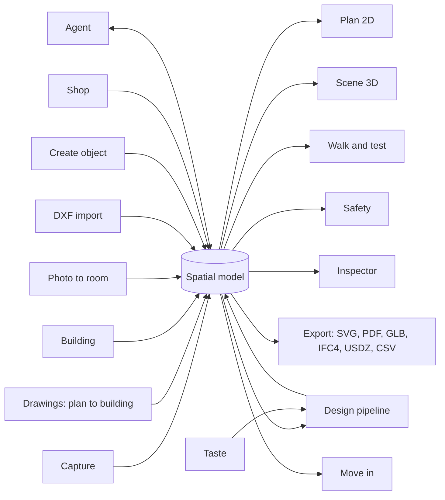

All inputs write into one spatial model that every view reads. Edits go through a single store with undo, so manual tools and the agent behave the same way.

The full reference (system and container diagrams, module map and dependency rule, data model, the independent checker, AI routing, state and undo, testing) is in [docs/ARCHITECTURE.md](docs/ARCHITECTURE.md). The reasons behind the main decisions are short records in [docs/adr/](docs/adr/README.md). `npm run check:boundaries` enforces the layering rules that hold today.

### Design pipeline

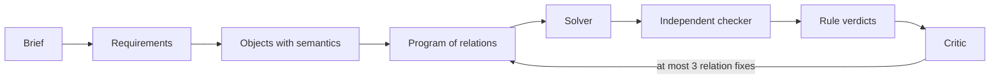

The planner decides intent (zones and relations, each with a reason) but never geometry. The solver turns relations into exact positions. The checker accepts or rejects them, the 42 rules score them, and the critic can send back relation edits for one more round. Without a model the planner and critic use rule-based fallbacks.

### Object creation

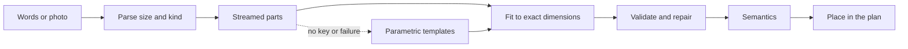

More detail in [docs/ARCHITECTURE.md](docs/ARCHITECTURE.md).

## Testing

```bash
npm run typecheck    # tsc -b
npm test             # Vitest, hermetic: no network and no key needed
npm run docs:rules   # print the design rule table (docs/DESIGN-RULES.md)
npm run docs:safety  # print the safety defaults (docs/SAFETY-ASSUMPTIONS.md)
```

The suite has 56 test files and 405 test cases, of which 11 are opt-in and skipped by default. Tests cover geometry, the store, the design solver and rules (including room scenarios), the critic, the referee, drawings answering, object validation, shop parsing, safety, rule packs, DXF reading, IFC and USDZ output, the move-in plan, taste learning, the shopping list, poll validation and the agent's pure logic. Server tests run with `npm run test:server`. Tests that need the network or a key are opt-in behind environment flags.

## Deployment

`.github/workflows/pages.yml` runs the tests, builds with the Pages base path and deploys `dist/` to GitHub Pages on every push to `main`. `.github/workflows/ci.yml` runs type-check, tests and build on every push and pull request. Neither needs secrets.

## Known limitations

- No accounts or database: models live in your browser and are not synced. Share links carry the whole model.
- Single-photo scale needs a reference object, such as an A4 sheet.
- Door and window counts from the plan-to-building step are weak (49% and 12% exact); room areas depend on outlines drawn in the PDF.
- The Render section is unverified for lack of image-model quota.
- AR export has not been tested on a device: the USDZ file is produced and unit-tested, but how it looks in AR Quick Look is unconfirmed.
- IFC4 walls are extruded solids without opening voids: doors and windows are separate elements placed at the wall, not cut into it.
- Polls are held in the server's memory (up to 300 polls, 48 hours each) and are lost when the server restarts.
- Room sizes from a photo are estimates; type the length of one wall to anchor the scale.
- The Finland and Sweden packs cover the values in `docs/RULE-SOURCES.md` only; the Finnish texts are the original versions as published, with later amendments not checked.
- DXF import reads ASCII DXF only.
- The drawings answerer abstains on about half of the Stoa questions and is weakest on areas; it reads text-based PDFs, not scans.
- Safety and accessibility checks are planning aids on stated defaults, not a code compliance check.
- Generated floors and rooms are estimates; walls are straight and rectilinear.
- Furniture passage and the design rules work on 2D footprints plus stated heights.
- Shop results depend on what the shop pages expose, and prices are as read at search time.
- 3D lighting is illustrative.
- Model features need a Gemini key and the quota of that key.

## Roadmap

- A server-side proxy for the model so keys never reach the browser.
- Native capture with RoomPlan (iOS) and ARCore (Android).
- Stitching several rooms captured separately into one model.
- Curved and angled walls in the building step.
- Real furniture catalogue feeds.
- Scanned drawings through vision, with the same evidence highlighting.
- Better door and window detection in the plan-to-building step.

## Credits

- 3D models, textures and the HDRI are from [Poly Haven](https://polyhaven.com), released under CC0. Details in [`public/assets/models/CREDITS.md`](public/assets/models/CREDITS.md) and [`public/assets/CREDITS-env.md`](public/assets/CREDITS-env.md).
- Sample floor plans are from the Swiss Dwellings dataset as provided with the Stoa challenge, licensed CC BY 4.0.

## Contributing

Issues and pull requests are welcome. See [CONTRIBUTING.md](CONTRIBUTING.md); in short, run `npm run typecheck`, `npm run check:boundaries`, `npm test` and `npm run build` first, as CI does. Security reports go through [SECURITY.md](SECURITY.md).

## License

[MIT](LICENSE)

## Author

[shafir-01](https://github.com/shafir-01), with the team Shafir Khajo, Julius Hänninen and Kalle Pentikäinen.
