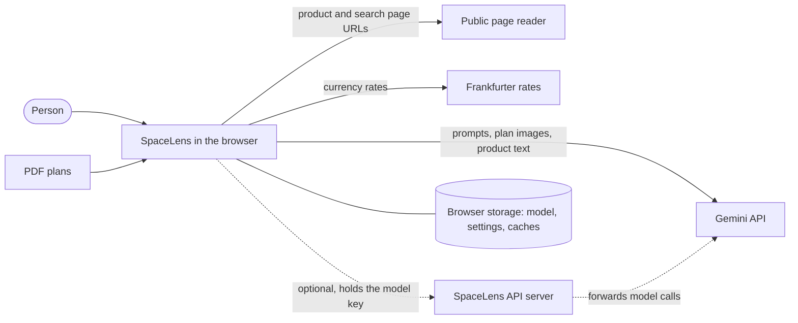
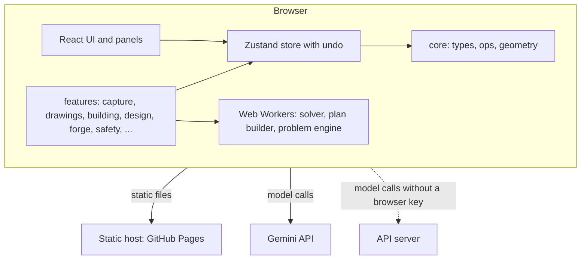
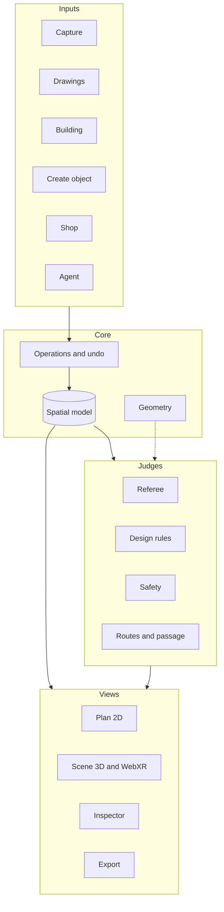
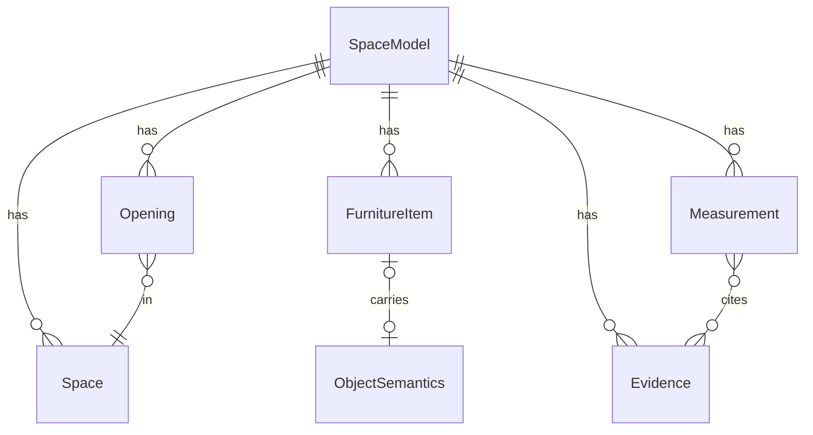
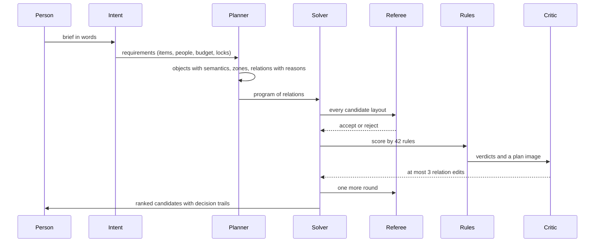
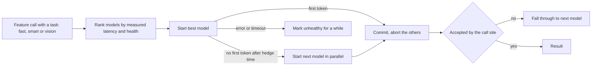

# Architecture

This is the reference for how SpaceLens is put together. Decisions and their reasons are in [adr/](adr/README.md); the security view is in [THREAT-MODEL.md](THREAT-MODEL.md).

SpaceLens is a single-page app. One metric, typed spatial model holds everything that is known about a place. Every feature either writes to it or reads from it, and every change goes through one store, so undo, the Inspector and the talking agent all see the same history. The only things that need a server are secrets and cross-origin reads, and those are handled by a small optional API server (see [Container view](#container-view)).

## System context

Everything that leaves the device is listed in [PRIVACY.md](PRIVACY.md).

## Container view

The built site is static files. The API server is described in `server/` (its README and code are the source of truth for routes and configuration).

## Layers

- `src/core/types.ts` is the contract: the model, requirements, relations, rule verdicts, object specs.
- `src/core/ops.ts` applies typed operations (set a wall length, move a corner, add an opening, place or update an object, replace the model, add evidence, set a measurement). Each operation produces a new model version and a one-line description for the change log.
- `src/core/store.ts` is a zustand store holding the model with past and future stacks, the active view, the requirements, the candidate layouts and the settings.
- Features live in `src/features/*` and depend on core. The shared judges (`referee`, `design/rules`) and `sim` are used across features.

## Module map and dependency rule

| Area | Path | Owns |
| --- | --- | --- |
| Contract | `src/core/types.ts` | Model, requirements, relations, verdicts, object specs |
| Operations | `src/core/ops.ts` | Pure reducer for every edit |
| Geometry | `src/core/geometry.ts` | Vector and polygon maths used by the app |
| Store | `src/core/store.ts` | Model, undo and redo stacks, settings, toasts |
| Model access | `src/core/ai/*` | Streaming client, model list, router, error categories |
| Inputs | `capture`, `drawings`, `building`, `forge`, `stores`, `vision`, `voice`, `agent` | Ways of writing into the model |
| Judges | `referee`, `design/rules.ts`, `safety`, `sim`, `problems` | Verdicts about a model; none of them edit it |
| Design | `design`, `layout`, `intent`, `themes`, `budget` | Brief to ranked candidate layouts |
| Views | `plan2d`, `scene3d`, `xr`, `ar`, `render`, `provenance`, `export` | Read the model and draw or export it |
| Shell | `src/ui/*`, `src/App.tsx` | Navigation, theme, settings, toasts, shared icons |

The rule: `core` depends on nothing in `features` or `ui`, and the referee's decision code depends only on core types and its own geometry file. `scripts/check-boundaries.mjs` enforces exactly that (`npm run check:boundaries`, run in CI).

What the check found today, reported as it is:

- The enforced rules pass. The single listed exception is `src/core/ai/AiStatus.tsx`, a status chip that sits beside the router and imports the shell's UI store.
- The wider rule, that features depend on each other only through contracts, does not hold and is not enforced. There are 78 directed import pairs between features, and 8 pairs import each other: `ar` and `export`, `building` and `sim`, `building` and `design`, `demo` and `intent`, `design` and `layout`, `design` and `themes`, `furniture` and `plan2d`, `problems` and `referee`. `npm run check:boundaries -- --pairs` lists them all.
- The mutual pair `problems` and `referee` is the panel component in `referee/ChecksPanel.tsx` importing problem cards. It does not touch the referee's decision code.
- Features import the shell's icons, notifications and UI store directly. That is accepted: `ui` is treated as a shared kit.

Tightening the feature graph (breaking the eight cycles through core types or small interfaces) is the main open architecture task.

## Data model

- A **Space** is a polygon in metres with per-wall metadata. A building is one space per room; shared walls are carried by both rooms on the same line, each side holding half the wall.
- A **Measurement** has a value, a `sourceKind` (user-measured, depth, photo-inferred, PDF annotation, manual, catalogue, generated, sample), a `status` (verified, estimated, conflicting, unknown), an optional tolerance, and the ids of the **Evidence** that supports it (a photo, a PDF page with a highlighted region, a manual entry).
- A **FurnitureItem** is a footprint with a rotation, a clearance on each side, a price status and optionally semantics. Catalogue pieces and generated objects are the same type, so every judge treats them alike.

## The drawings answerer

`src/features/drawings` extracts text with pdf.js in the browser and builds an index: text items with positions, dimension strings, scale, room labels and unit labels. `answer.ts` classifies the question and answers from that index. Each answer says whether it is printed on the page, calculated from printed values, or inferred, and carries the page regions that justify it. When the index cannot support an answer it abstains; Gemini is only asked when a key is set and the local index has nothing. The benchmark in `src/features/drawings/stoa.eval.test.ts` runs this same code with no model calls.

## Plan to building

Vector PDF plans are converted into a multi-room spatial model without a model call. Room outlines drawn in the PDF become spaces, wall thickness is read from the drawing, door symbols and window openings are attached to the walls they touch, and printed room areas are compared with the computed ones. Each wall carries evidence (page and region), so the page can be highlighted from the model. The benchmark runner is `scripts/stoa-build.mjs` and its results are `public/samples/stoa/build-results.json`. Door and window detection is the weak part, and rooms built from walls alone are less accurate than rooms with a drawn outline.

## Whole buildings

A built or generated floor can be furnished room by room through the same design pipeline, walked through its doors, and toured automatically. Shared walls are held by both rooms, so connectivity and routes work across rooms.

## Building from a programme

`src/features/building`: `programme.ts` holds room programmes (area, minimum width, window need, zone), `partition.ts` divides an outer shell into rectangles that meet those needs, `connectivity.ts` checks that every room can be reached from the entrance, and `assemble.ts` converts the plan into the spatial model: one space per room, doors on both sides of a shared wall, windows on facades. Everything it makes is tagged as a generated estimate.

## Design pipeline

| Stage | File | What it does |
| --- | --- | --- |
| Requirements | `intent/compile.ts` | Turns a request into typed requirements, from Gemini or built-in rules. |
| Objects and semantics | `design/semantics.ts` | Role, zone, use zones, front, and whether a piece pairs (seat with desk) or hosts (rug). |
| Program | `design/planner.ts`, `design/program.ts` | Zones and relations such as against-wall, faces, flanks, beside, in-front-of, on-rug, apart-from, aligned-with. The planner decides intent, never coordinates. Without a key a rule-based program is used. |
| Solver | `design/solve.ts` | A hierarchical constructive search. Anchors (bed, TV wall, desk, counter, tables) are tried in exact wall slots, corners and free regions; dependents follow from relations; a beam keeps the best and most different partial layouts; a local pass slides groups to raise the score. |
| Independent checker | `referee/validate.ts` | Pure geometry: inside the room, no overlaps, door swing, approach and window access. Every returned layout passes it. See [The independent checker](#the-independent-checker). |
| Rule verdicts | `design/rules.ts` | 42 rules, each a pure function returning a 0 to 1 score and a sentence with measured numbers. See [DESIGN-RULES.md](DESIGN-RULES.md). |
| Critic | `design/critic.ts` | Judges each major decision and may add, remove or reweight at most three relations. It never moves geometry. |
| Pipeline | `design/pipeline.ts` | Runs the stages, reports each one's status and time, and returns candidates with their full trail. |

When no layout can satisfy the request, `layout/solver.ts` explains which constraint is the blocker and suggests the smallest relaxation.

## Object creation

`src/features/forge`: `parseRequest.ts` reads kind and size from the words; `generate.ts` asks the model for parts (box, rounded, cylinder, cone, sphere, cushion, leg, panel, tube, extrude, lathe) and streams them so the object assembles while it is being written; `fit.ts` scales the result to the exact requested dimensions; `validate.ts` checks and repairs geometry (minimum parts, contact between parts, size tolerance), and one repair pass is requested from the model if it is still broken; `materials.ts` maps material ids to textures and colours. Without a key, or on failure, `rulesFallback.ts` and the parametric templates in `library.ts` produce the object. The result is a `FurnitureItem` with semantics, so the design rules apply to it.

## Shop

`src/features/stores`: `search.ts` finds listings (Gemini with Google Search grounding when available, otherwise a plain web results page through a reader), `read.ts` reads each product page so price and size come from the listing, `parse.ts` extracts query limits such as a budget and a maximum width, and `advise.ts` checks each listing against a free spot in the room, the door and the budget. A fast model only words the reasons.

## The agent

`src/features/agent`: `brain.ts` sends the person's words and a compact picture of the room to the model and parses a streamed reply of what to say, what to sketch and which actions to run. The first finished sentence is spoken while the rest arrives. `actions.ts` defines the action set and carries each one out through the store and the feature modules; each action is first sketched on the plan (`SketchLayer.tsx`) so the person sees what it means before it happens. `deixis.ts` resolves "that", "here" and wall names against the room and the latest sketch. `speech.ts` wraps browser speech recognition and synthesis. `offline.ts` handles commands that do not need a model.

## Budget and render

`src/features/budget` keeps the shopping list inside a budget (`optimise.ts` proposes swaps and checks them with the rules and the referee, `phases.ts` splits the purchase into now, next and later, `argue.ts` words the reasons). `src/features/render` captures the scene and asks an image model for a picture of the finished room; it is untested because the image models had no quota on the available key.

## Safety

`src/features/safety`: `field.ts` builds a grid of the walkable floor with door and clearance information, `assess.ts` runs the assessments (routes, exits, dead ends, wheelchair access, extinguisher and alarm placement, suggestions with a maximum move), `evac.ts` simulates people walking to the nearest exit and queueing at doors, and `plan.ts` writes the printable A4 SVG. All thresholds are in one defaults object; see [SAFETY-ASSUMPTIONS.md](SAFETY-ASSUMPTIONS.md).

## The independent checker

`src/features/referee/validate.ts` decides whether a layout is valid: furniture inside the room, no overlaps, door swing and approach clear, window access, plus checks tied to the requirements. It has its own small geometry file, `referee/geom.ts`, which says in its first line that it is deliberately independent of `src/core/geometry.ts`. The reason is that a bug in shared maths would otherwise make the solver and its judge wrong in the same way, and the check would pass anyway.

What is and is not independent, stated exactly:

- The referee imports only core types and its own geometry (enforced by `check:boundaries`). It never imports the solver, the rules or any model code.
- The room layout solver (`layout/solver.ts`) uses `core/geometry.ts`, so it shares no geometry code with the referee.
- The design solver (`design/solve.ts`) imports the referee's primitives (`overlapDepth`, `pointInPolygon`, `rectOutside`, `distPointRect`) for its own fast hard checks, which it marks as mirroring the referee. It also keeps a safety margin inside the referee's 1 cm tolerance and finishes by calling `validateLayout`. So for that solver the final verdict is independent logic, but the low-level primitives are shared. A fault in `referee/geom.ts` would affect both.

Every candidate the design solver returns has passed `validateLayout`, and the same function runs on hand edits through the problems engine (`problems/engine.ts`, in a Web Worker).

## Deterministic solving

`design/solve.ts` takes a `seed` and never reads the clock to decide when to stop; the `timeBudgetMs` option scales a fixed amount of search work (see [ADR 7](adr/0007-deterministic-seeded-solver.md)). The same seed and inputs give the same layouts on any machine, which is what lets the scenario tests assert on outcomes.

## AI routing

`core/ai/engine.ts` makes one streaming request (`streamGenerateContent`, server-sent events parsed by `sse.ts`) with a first-token timeout and a total timeout. `core/ai/router.ts` probes the models on the key, ranks each task's candidates by measured latency (quality order only among models within 2x of the fastest and under 4 s), and tracks health: a model that returns 404 is skipped for the session, quota errors for 10 minutes, 503 for 90 seconds, other failures for 5. Hedging starts the next model in parallel if the first has not produced a token after 4 s (fast) or 8 s (smart, vision); the first to stream text wins. Probe results and learned model lists are cached in browser storage so a reload does not re-measure. `errors.ts` maps failures to plain categories for the UI. Every call site has a local fallback.

## Evidence and status

Measurements carry a source kind and a status, and the Inspector (`provenance/`) lets a person trace any number to its evidence. Estimates produced by the app (generated rooms, shop prices, single-photo scale, evacuation times) are labelled where they appear. Details are in [ADR 8](adr/0008-evidence-and-status-on-every-measurement.md).

## State management and undo

All edits are `Op` values (a union in `core/types.ts`) applied by the pure reducer `applyOp`. `store.dispatch` applies one, pushes the previous model on `past` (capped at the last 100), clears `future`, and records a one-line change description. `undo` and `redo` swap models between the stacks and bump the version. The model is autosaved to browser storage on a debounce and restored on load. The agent, the 2D tools, the design pipeline and the Inspector all use `dispatch`, so there is one history. UI-only state (current section, collapsed navigation, theme) lives in `ui/uiStore.ts` and is not undoable.

## Performance notes

- Heavy sections (3D scene, drawings, export, forge, safety, shop, agent) are code-split with `React.lazy` and load on first use.
- The layout solver, plan builder and the problems engine run in Web Workers. The solver wrapper falls back to the main thread where workers are missing, such as in tests.
- The 3D canvas renders on demand unless something is animating, caps the pixel ratio at 2 and lowers resolution when the frame rate drops.
- Problems are recomputed on a debounce after each change and ranked, so typing in a field does not run the whole check on every key.
- The design pipeline shows rule-based layouts first and improves them as model results arrive.

## Testing strategy

- Vitest in a Node environment, hermetic: no network, no API key. At the time of writing there are 43 test files with about 309 test cases (counted from `it(` and `test(` calls, so parameterised cases count once).
- Pure logic is tested directly: geometry, operations and store, solver and design scenarios (room scenarios in `design/scenarios.ts`), rules, referee, critic parsing, kits and object validation, shop parsing, safety, speech sentence splitting, sharing and export, model routing and error categories.
- The Stoa benchmarks (`drawings/stoa.eval.test.ts`, `drawings/stoa.build.eval.test.ts`) run the real extraction code with no model calls; live-model scripts (`scripts/forge-live.mjs`, `scripts/*-live.test.ts`) are opt-in through environment flags.
- Browser checks use headless scripts in `scripts/e2e` (screenshots, DOM queries, performance) and are run by hand, not in CI.
- CI runs type check, the boundary check, the tests and the production build on every push and pull request.
