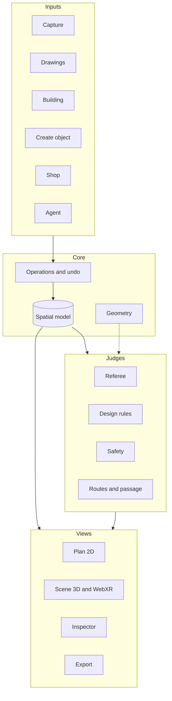
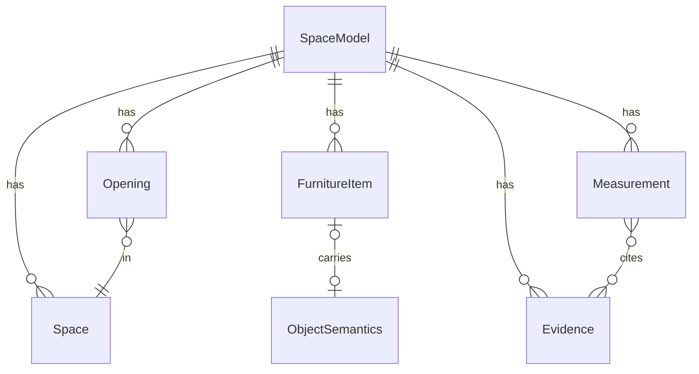
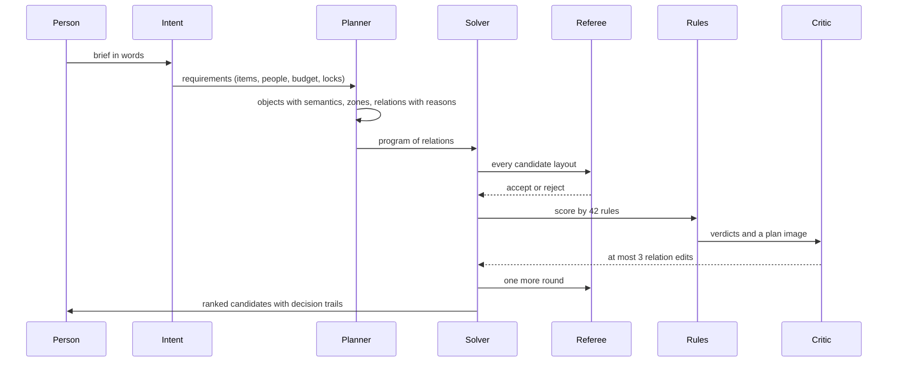

# Architecture

SpaceLens is a single-page app with no backend. One spatial model holds everything that is known about a place, every feature either writes to it or reads from it, and every change goes through one store so that undo, the Inspector and the talking agent all see the same history.

## Layers

- `src/core/types.ts` is the contract: the model, requirements, relations, rule verdicts, object specs.
- `src/core/ops.ts` applies typed operations (set a wall length, move a corner, add an opening, place or update an object, replace the model, add evidence, set a measurement). Each operation produces a new model version and a one-line description for the change log.
- `src/core/store.ts` is a zustand store holding the model with past and future stacks, the active view, the requirements, the candidate layouts and the settings.
- Features live in `src/features/*` and depend on core. The shared judges (`referee`, `design/rules`) and `sim` are used across features.

## Data model

- A **Space** is a polygon in metres with per-wall metadata. A building is one space per room; shared walls are carried by both rooms on the same line, each side holding half the wall.
- A **Measurement** has a value, a `sourceKind` (user-measured, depth, photo-inferred, PDF annotation, manual, catalogue, generated, sample), a `status` (verified, estimated, conflicting, unknown), an optional tolerance, and the ids of the **Evidence** that supports it (a photo, a PDF page with a highlighted region, a manual entry).
- A **FurnitureItem** is a footprint with a rotation, a clearance on each side, a price status and optionally semantics. Catalogue pieces and generated objects are the same type, so every judge treats them alike.

## The drawings answerer

`src/features/drawings` extracts text with pdf.js in the browser and builds an index: text items with positions, dimension strings, scale, room labels and unit labels. `answer.ts` classifies the question and answers from that index. Each answer says whether it is printed on the page, calculated from printed values, or inferred, and carries the page regions that justify it. When the index cannot support an answer it abstains; Gemini is only asked when a key is set and the local index has nothing. The benchmark in `src/features/drawings/stoa.eval.test.ts` runs this same code with no model calls.

## Building from a programme

`src/features/building`: `programme.ts` holds room programmes (area, minimum width, window need, zone), `partition.ts` divides an outer shell into rectangles that meet those needs, `connectivity.ts` checks that every room can be reached from the entrance, and `assemble.ts` converts the plan into the spatial model: one space per room, doors on both sides of a shared wall, windows on facades. Everything it makes is tagged as a generated estimate.

## Design pipeline

| Stage | File | What it does |
| --- | --- | --- |
| Requirements | `intent/compile.ts` | Turns a request into typed requirements, from Gemini or built-in rules. |
| Objects and semantics | `design/semantics.ts` | Role, zone, use zones, front, and whether a piece pairs (seat with desk) or hosts (rug). |
| Program | `design/planner.ts`, `design/program.ts` | Zones and relations such as against-wall, faces, flanks, beside, in-front-of, on-rug, apart-from, aligned-with. The planner decides intent, never coordinates. Without a key a rule-based program is used. |
| Solver | `design/solve.ts` | A hierarchical constructive search. Anchors (bed, TV wall, desk, counter, tables) are tried in exact wall slots, corners and free regions; dependents follow from relations; a beam keeps the best and most different partial layouts; a local pass slides groups to raise the score. |
| Independent checker | `referee/validate.ts` | Pure geometry: inside the room, no overlaps, door swing, approach and window access. Every returned layout passes it. |
| Rule verdicts | `design/rules.ts` | 42 rules, each a pure function returning a 0 to 1 score and a sentence with measured numbers. See [DESIGN-RULES.md](DESIGN-RULES.md). |
| Critic | `design/critic.ts` | Judges each major decision and may add, remove or reweight at most three relations. It never moves geometry. |
| Pipeline | `design/pipeline.ts` | Runs the stages, reports each one's status and time, and returns candidates with their full trail. |

When no layout can satisfy the request, `layout/solver.ts` explains which constraint is the blocker and suggests the smallest relaxation.

## Object creation

`src/features/forge`: `parseRequest.ts` reads kind and size from the words; `generate.ts` asks the model for parts (box, rounded, cylinder, cone, sphere, cushion, leg, panel, tube, extrude, lathe) and streams them so the object assembles while it is being written; `fit.ts` scales the result to the exact requested dimensions; `validate.ts` checks and repairs geometry (minimum parts, contact between parts, size tolerance), and one repair pass is requested from the model if it is still broken; `materials.ts` maps material ids to textures and colours. Without a key, or on failure, `rulesFallback.ts` and the parametric templates in `library.ts` produce the object. The result is a `FurnitureItem` with semantics, so the design rules apply to it.

## Shop

`src/features/stores`: `search.ts` finds listings (Gemini with Google Search grounding when available, otherwise a plain web results page through a reader), `read.ts` reads each product page so price and size come from the listing, `parse.ts` extracts query limits such as a budget and a maximum width, and `advise.ts` checks each listing against a free spot in the room, the door and the budget. A fast model only words the reasons.

## The agent

`src/features/agent`: `brain.ts` sends the person's words and a compact picture of the room to the model and parses a streamed reply of what to say, what to sketch and which actions to run. The first finished sentence is spoken while the rest arrives. `actions.ts` defines the action set and carries each one out through the store and the feature modules; each action is first sketched on the plan (`SketchLayer.tsx`) so the person sees what it means before it happens. `deixis.ts` resolves "that", "here" and wall names against the room and the latest sketch. `speech.ts` wraps browser speech recognition and synthesis. `offline.ts` handles commands that do not need a model.

## Safety

`src/features/safety`: `field.ts` builds a grid of the walkable floor with door and clearance information, `assess.ts` runs the assessments (routes, exits, dead ends, wheelchair access, extinguisher and alarm placement, suggestions with a maximum move), `evac.ts` simulates people walking to the nearest exit and queueing at doors, and `plan.ts` writes the printable A4 SVG. All thresholds are in one defaults object; see [SAFETY-ASSUMPTIONS.md](SAFETY-ASSUMPTIONS.md).

## Model access

`src/core/ai` is a small streaming client for Gemini over `fetch`. `models.ts` lists candidate models per task (fast, smart, vision); `router.ts` picks the first healthy one by measured latency and marks a model unhealthy for a while after a quota error or timeout. `partialJson.ts` parses JSON as it streams so the UI can show parts and sentences as they arrive. Every call site has a local fallback, so a failing model never blocks the app.

## Tests

Vitest, hermetic. Pure logic (geometry, operations, solver, rules, referee, critic, object validation, shop parsing, safety, speech sentence splitting) is covered directly, and the design solver is exercised on room scenarios. The Stoa benchmark and any live-model script are opt-in through environment flags.
