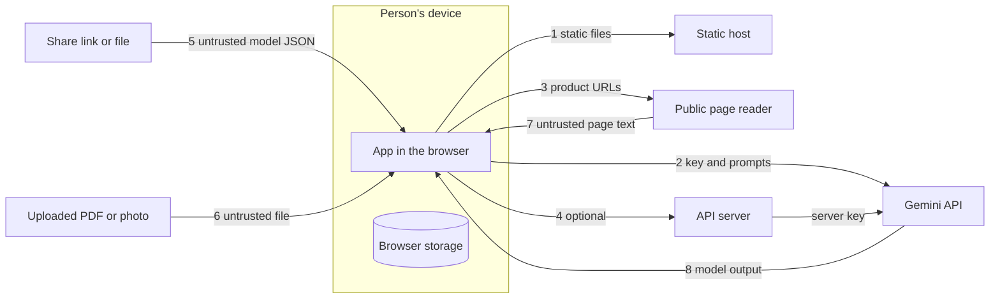

# Threat model

Scope: the SpaceLens web app (`src/`), its production build served as static files, and the optional API server in `server/`. Reporting a problem: see [SECURITY.md](../SECURITY.md). What data goes where: [PRIVACY.md](PRIVACY.md).

## Assets

| Asset | Where it lives | Why it matters |
| --- | --- | --- |
| Gemini API key (a person's own) | Browser storage (`spacelens.settings.v1`), memory, or a `#key=` setup link | Spending and quota belong to its owner |
| Gemini API key (server) | Environment variable `GEMINI_API_KEY` of the server process | Anyone who gets it spends the operator's quota |
| The model: a person's rooms, plans and photos | Browser storage, and inside share links | Floor plans of homes and workplaces are private |
| The shared daily AI allowance | `server/security.mjs` budget | A hard cost ceiling for the operator |
| Integrity of verdicts (valid layout, safety notes) | Referee and rule code | People may act on them |

## Trust boundaries

Untrusted inputs are 5 to 8: a model arriving by link or file, a PDF or photo, text from a web page, and model output. Treating model output as untrusted is why geometry decisions are not left to it (see [ADR 3](adr/0003-relations-then-solve.md)).

## Threats and mitigations

STRIDE categories: Spoofing, Tampering, Repudiation, Information disclosure, Denial of service, Elevation of privilege.

| # | Threat | Cat. | Mitigation in the code | Residual |
| --- | --- | --- | --- | --- |
| 1 | Script injection into the app (XSS) | T, E, I | Production CSP in `index.html` (from `.env.production`): scripts from the site only, `object-src 'none'`, `base-uri 'self'`. React escapes text. The only `dangerouslySetInnerHTML` uses (`building/BuildingPanel.tsx`, `export/ExportPanel.tsx`) render SVG built by the app, and `export/svg.ts` escapes names with `esc()` | Styles allow `unsafe-inline` (React inline styles). `connect-src` lists the Gemini, reader and rates origins |
| 2 | Hostile model JSON in a share link or file | T, E | `export/share.ts` decodes through `export/validate.ts`, which rejects non-objects, wrong units, rooms without 3 numeric corners, and fills wall defaults. Evidence images are removed from share links | Validation checks the shape of rooms, not every field of furniture and measurements; those are used as data, never as markup |
| 3 | Hostile text in a read store page | T | Page text is only used as data: parsed for price, size and images, and sent to the model with an instruction to ignore related products (`stores/read.ts`). Links open with `rel="noopener noreferrer"` | A page can still mislead the extracted price or size; prices are labelled as read at search time |
| 4 | Prompt injection through a PDF, photo or page | T | Model output only fills typed fields: requirements, relations, parts. The solver and the referee decide geometry; the critic can change at most three relations. Model outputs are parsed against schemas and coerced (`forge/spec.ts` `coerceItem`) | A model can still produce a worse design or a wrong answer; the Inspector and the referee show what was checked |
| 5 | A person's key leaks from storage | I | Key is stored only in this browser. The setup link `#key=` goes after the hash, so it is not sent to a server, is validated against a key pattern and is removed from the address bar at once (`core/store.ts`). The key is sent only in the `x-goog-api-key` header to Gemini. The deployed bundle contains no key: `VITE_GEMINI_KEY` is read only in development | Any script on the page can read storage, so CSP matters. Setup links are secrets and can land in history if shared carelessly |
| 6 | Server key abuse | I, D | Key only in server environment (`server/config.mjs`), never returned to clients; upstream errors are replaced by stable codes (`server/gemini.mjs`); origin allowlist with CORS (`server/security.mjs`); per-client token bucket and a shared daily budget; request body cap; model allowlist; strict request schema that forwards only known fields (`server/schema.mjs`); upstream timeout; logs hold no bodies, keys or client addresses (`server/log.mjs`) | The origin check keeps other websites from calling the API from a visitor's browser, but a script outside a browser can send any `Origin`. The rate limit and the daily budget bound the cost of that |
| 7 | Server resource exhaustion | D | Body size cap read while streaming, JSON-only media type, bounded schema size, `AbortSignal` on client disconnect, bounded limiter memory (`server/http.mjs`, `server/security.mjs`) | A large attack from many addresses is bounded by the daily budget, which then also denies honest users |
| 8 | Someone spoofing the rate-limit address | S | Forwarded headers are trusted only when `CLIENT_IP_HEADER` is configured, counted from the right by `TRUSTED_PROXY_HOPS` (`server/security.mjs`) | A wrong proxy setting by the operator weakens the limit |
| 9 | Clickjacking and content sniffing on the API | T | Security headers on every server response (`SECURITY_HEADERS` in `server/http.mjs`) | None known for the API. The static host sets its own headers for the app |
| 10 | Dependency compromise | T, E | Exact version pins in `package.json`, a lock file, `npm ci` in CI, Dependabot updates (`.github/dependabot.yml`), CI token with read-only permissions | Pinning does not detect a malicious release by itself; updates are reviewed by hand |
| 11 | Secrets committed to the repo | I | `.env`, `.env.local` ignored by git (`.gitignore`); `.env.example` has no value; `.env.production` holds only the CSP | No automated secret scan runs in CI yet |
| 12 | Incorrect verdict presented as a guarantee | R | Safety and rule output is labelled a planning aid with stated defaults (`docs/SAFETY-ASSUMPTIONS.md`); estimates are labelled; every change goes through the logged store | People can still over-trust a green check |

## Not protected yet

Stated plainly so nobody assumes otherwise:

- **No accounts.** There is no login, no per-person access control and nothing server-side to protect a model.
- **Share links carry the whole model.** Anyone who has a link can read it, and links cannot be revoked. Photos are left out, but rooms, furniture and measurements are not.
- **Client-side key mode exposes the key to that user.** A key pasted into Settings is readable by that person, by browser extensions, and by any script that runs on the page. Use a key with a spending cap, or the API server.
- **Third-party page reader.** Store links and search words go through a public reader (`r.jina.ai`), which can see them and can return any text.
- **Uploaded plans stay in the browser.** That is a privacy benefit and a risk: they are unencrypted in site storage and are lost if the site data is cleared.
- **Store image fetches.** The production CSP allows requests only to the listed origins, so reading a store image as a file for 3D conversion works only where the store allows it through the listed origins; otherwise the app shows the plain picture and asks you to drop the image. This is a deliberate trade for a tighter policy.
- **The API server is not yet wired into the app.** The client calls Gemini directly today. When it is wired, its origin must be added to `connect-src`.
- **No automated dependency vulnerability scan or secret scan in CI.**
- **The CSP is delivered as a meta tag.** `frame-ancestors` and similar directives do not work in a meta tag, so framing protection depends on the static host.
