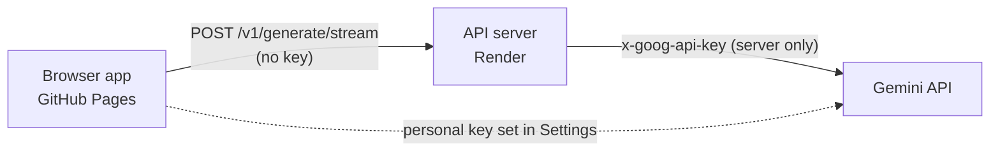

# SpaceLens API server

A small HTTP server that holds the Gemini key, so the app works on any device without anyone pasting a key. It runs on Node 22+ built-ins only (`node:http`, `fetch`, `crypto`, `node:test`): nothing to install.



The browser picks the route by itself: a personal key set in Settings (or `VITE_GEMINI_KEY` in development) calls Google directly; otherwise calls go to the server at `VITE_API_BASE`; with neither, the app runs on offline rules.

## Endpoints

| Method | Path | What it does |
| --- | --- | --- |
| GET | `/healthz` | `{"status":"ok"}` for the platform health check |
| GET | `/v1/models` | Allowed models the key can call, in order of preference (cached) |
| POST | `/v1/generate` | One Gemini `generateContent` call, JSON in and out |
| POST | `/v1/generate/stream` | Server-sent events, passed through from `streamGenerateContent` chunk by chunk |

Request body for both generate routes (anything else is refused with a 400 naming the field):

```json
{
  "model": "gemini-3.5-flash-lite",
  "contents": [{ "role": "user", "parts": [{ "text": "Say hello" }] }],
  "generationConfig": { "temperature": 0.2, "thinkingConfig": { "thinkingLevel": "low" } },
  "systemInstruction": { "parts": [{ "text": "Be brief." }] },
  "tools": [{ "google_search": {} }]
}
```

Every error uses one shape, with a stable `code` and a plain message. Upstream error text is never passed on:

```json
{ "error": { "code": "rate_limited", "message": "Too many requests. Wait a moment and try again." } }
```

## Security

- **Key**: read from the environment only. It is never accepted from a client, never sent back, never logged (tests check every response and log line).
- **CORS**: only listed origins get `Access-Control-Allow-Origin`; other origins get a 403. Preflights allow `GET`, `POST` and the `Content-Type` and `X-Request-Id` headers only. Generate calls must carry an allowed `Origin`.
- **Limits**: a token bucket per client address (`RATE_LIMIT_BURST`, refilled at `RATE_LIMIT_PER_MINUTE`) and a shared daily allowance (`RATE_LIMIT_DAILY`, resets at 00:00 UTC). Both answer 429 with `Retry-After`. Only valid requests spend the daily allowance.
- **Input**: body cap (`MAX_BODY_BYTES`, checked against the declared length and while reading), JSON only, model allowlist, strict field-by-field schema; search grounding is the only tool forwarded.
- **Upstream**: a total timeout (`UPSTREAM_TIMEOUT_MS`), and the Gemini call is aborted as soon as the browser disconnects.
- **Headers**: `nosniff`, `no-store`, HSTS, `default-src 'none'` CSP, `Referrer-Policy: no-referrer`, `X-Frame-Options: DENY`.
- **Client address**: the socket address unless `CLIENT_IP_HEADER` is set. With `x-forwarded-for`, the entry added by the platform proxy is used (counted from the right by `TRUSTED_PROXY_HOPS`), never the client-controlled left end.
- **Logs**: one JSON line per request with a request id, route, status, duration and model. No bodies, keys or addresses.

## Run locally

```bash
GEMINI_API_KEY=your-key npm run server          # listens on http://localhost:8787
# or keep the variables in a file that is never committed:
node --env-file=server/.env server/index.mjs
```

Then point the app at it in `.env.local` (and leave `VITE_GEMINI_KEY` empty, or it calls Google directly):

```bash
VITE_API_BASE=http://localhost:8787
```

```bash
curl http://localhost:8787/healthz
curl -N http://localhost:8787/v1/generate/stream \
  -H 'Origin: http://localhost:5180' -H 'Content-Type: application/json' \
  -d '{"model":"gemini-3.5-flash-lite","contents":[{"parts":[{"text":"Count to 5"}]}]}'
```

## Configuration

| Variable | Default | Meaning |
| --- | --- | --- |
| `GEMINI_API_KEY` | (required) | Server-side Gemini key |
| `ALLOWED_ORIGINS` | Pages origin and local dev ports | Comma-separated origins; `http://localhost:*` allows any port |
| `MODEL_ALLOWLIST` | fast and mid-size Gemini models | Comma-separated model ids, preferred first |
| `RATE_LIMIT_BURST` | `20` | Requests a client may send at once |
| `RATE_LIMIT_PER_MINUTE` | `30` | Refill rate per client |
| `RATE_LIMIT_DAILY` | `3000` | Model calls per UTC day for everyone together |
| `MAX_BODY_BYTES` | `8000000` | Largest request body (images travel as base64) |
| `UPSTREAM_TIMEOUT_MS` | `120000` | Total time allowed for one Gemini call |
| `MODELS_CACHE_MS` | `600000` | How long the model list is cached |
| `CLIENT_IP_HEADER` | (socket address) | `x-forwarded-for`, or a header holding one address |
| `TRUSTED_PROXY_HOPS` | `1` | Proxies in front of the server that append to X-Forwarded-For |
| `REQUIRE_ORIGIN` | `true` | Refuse generate calls without an `Origin` header |
| `LOG_LEVEL` | `info` | `debug`, `info`, `warn`, `error` or `silent` |
| `PORT`, `HOST` | `8787`, `0.0.0.0` | Where to listen (Render sets `PORT`) |

Invalid settings stop the server at startup with a list of every problem.

## Deploy on Render (free tier)

1. In Render: **New > Blueprint**, pick this repository. `render.yaml` creates the `spacelens-api` web service (Node, free plan, start command `node server/index.mjs`, health check `/healthz`).
2. Enter `GEMINI_API_KEY` when asked. Adjust the optional variables under **Environment** if needed.
3. Deploy, then open `https://<service>.onrender.com/healthz`.

Manual setup works too: **New > Web Service**, runtime Node, build command `node --version`, start command `node server/index.mjs`, health check path `/healthz`, environment `NODE_VERSION=22`, `GEMINI_API_KEY`, `ALLOWED_ORIGINS=https://junction26.github.io`, `CLIENT_IP_HEADER=x-forwarded-for`.

Free instances sleep after a period without traffic; the first call after that waits while the instance starts.

## Connect the GitHub Pages build

1. Repository **Settings > Secrets and variables > Actions > Variables**: add `VITE_API_BASE` = `https://<service>.onrender.com` (no trailing slash).
2. `.github/workflows/pages.yml` passes it to the build. `.env.production` adds the same value to the page's Content-Security-Policy `connect-src`, so the browser is allowed to call it.
3. Re-run the Pages workflow. With no key set, the status chip reads "Gemini" and AI features go through the server.

## Tests

```bash
npm run test:server
```

`node:test` suites in `server/test/` run the full server on a random local port with a stubbed upstream (no network): validation, CORS and preflight, rate limit and daily allowance, body cap, model allowlist, streaming pass-through, error mapping, client disconnect, timeouts, and that no key or request content appears in any response or log line. CI runs them in the `server` job.
